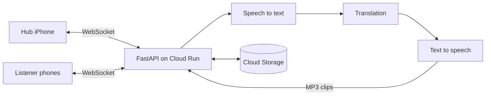

# Chongqing Family Translator

A voice-first web app for a family travelling with a Mandarin-speaking tour guide. One iPhone
acts as the hub, picking up the guide through a Bluetooth clip-on mic. Family members hear
Cantonese on their own phones and can send questions back for the guide to hear in Mandarin.

| Direction | Input | Output |
| --- | --- | --- |
| Guide → family | Mandarin speech or typed text on the hub | Cantonese audio, large-print colloquial Cantonese in Traditional characters, and English text |
| Family → guide | Cantonese or English, via push-to-talk or typing | Mandarin audio from the hub and Simplified Chinese text |

Listeners join through a shared link. They can pause live playback, replay individual voice
notes, and catch up after reconnecting. The hub PIN enables family replies, and the hub waits
for a pause in the guide's speech before playing them.

## How it works



The **Vue 3** progressive web app uses Silero voice activity detection to send guide speech in
segments. The **Python 3.12 / FastAPI** backend processes the transcript sentence by sentence,
using Google Chirp 3 for transcription, Gemini on Vertex AI for translation, and Google
Text-to-Speech for audio. Provider fallbacks run on the server. Listener phones cache clips in
IndexedDB for replay.

The default `chongqing` profile uses the languages above. The `cantonese-guide` profile swaps
the spoken languages for a Cantonese-speaking guide and a Mandarin-speaking family. The profile
is selected when the service starts. See the [architecture](docs/architecture.md#language-profiles-decided-23-nov).

## Run locally

You’ll need **Python 3.12**, **uv**, and **Node.js 24** with npm. Run these commands from the
repository root in two terminals.

**Backend**

```bash
cd backend
cp -n .env.example .env
# Fill in .env before trying a translation.
uv run uvicorn app.main:app --reload --port 8000
```

**Frontend**

```bash
cd frontend
npm ci
npm run vad-assets
npm run dev
```

Open [http://localhost:5173](http://localhost:5173) for the hub. Sign in with `HUB_PIN` and
`API_TOKEN` from your local `.env`. Open `/host` to sign in as a host and copy the listener join
link, then use the link in a separate browser profile to try the listener flow. The backend
health check is at [http://localhost:8000/health](http://localhost:8000/health).

For end-to-end translation, fill in `GCP_PROJECT`, `GROQ_API_KEY`, and `OPENAI_API_KEY` in
`backend/.env`. See [`.env.example`](backend/.env.example) for the available settings. Enable
Speech-to-Text, Vertex AI, Text-to-Speech, and Cloud Translation in your Google Cloud project,
then set up Application Default Credentials with `gcloud auth application-default login`.
Leave `CLIP_BUCKET` empty to keep local clips in memory. The test suites can run without provider
credentials. Microphone capture works on `localhost`. Use HTTPS when testing on a phone.

## Tests and build

```bash
# Backend, from the repository root
(cd backend && uv run pytest && uv run ruff check . && uv run ruff format --check .)

# Frontend, after npm ci
(cd frontend && npm test && npm run build)
```

The [Dockerfile](Dockerfile) packages the frontend and backend into one image. The
[deployment script](deploy.sh) targets Cloud Run. See the [working agreement](AGENTS.md#working-agreement)
for staging and deployment approvals.

## Repository guide

| Path | What’s inside |
| --- | --- |
| [`backend/`](backend/) | FastAPI app, WebSocket rooms, translation pipeline, provider adapters, and profile configuration |
| [`frontend/`](frontend/) | Vue app, microphone capture, listener playback, and clip cache |
| [`bakeoff/`](bakeoff/README.md) | Scripts for comparing speech recognition, translation models, and voices |
| [`docs/`](docs/) | [Architecture](docs/architecture.md), [decisions](docs/decisions.md), [bake-off results](docs/bakeoff-results.md), and [field test plan](docs/field-tests.md) |
