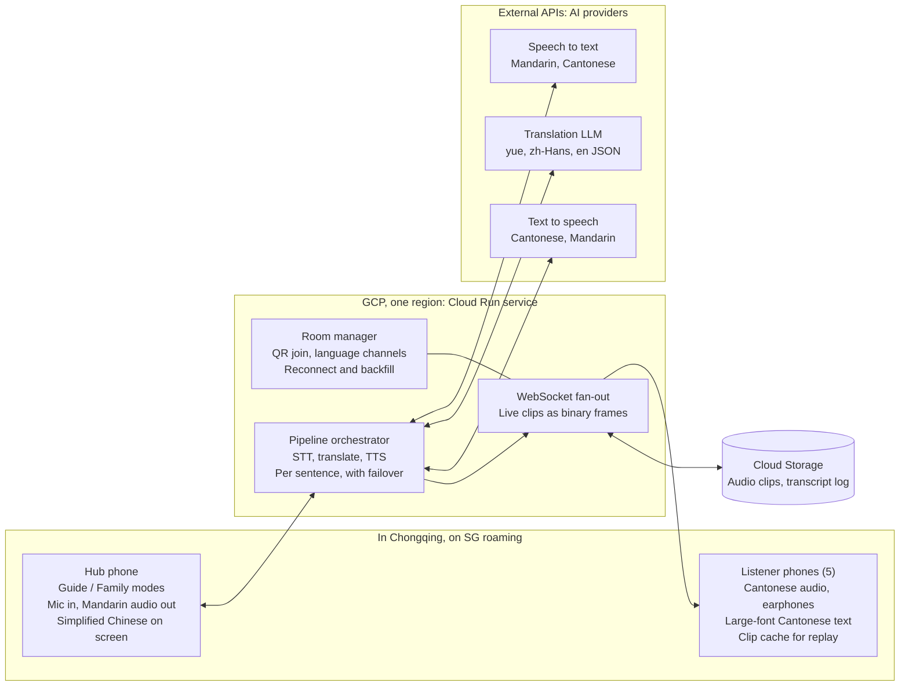
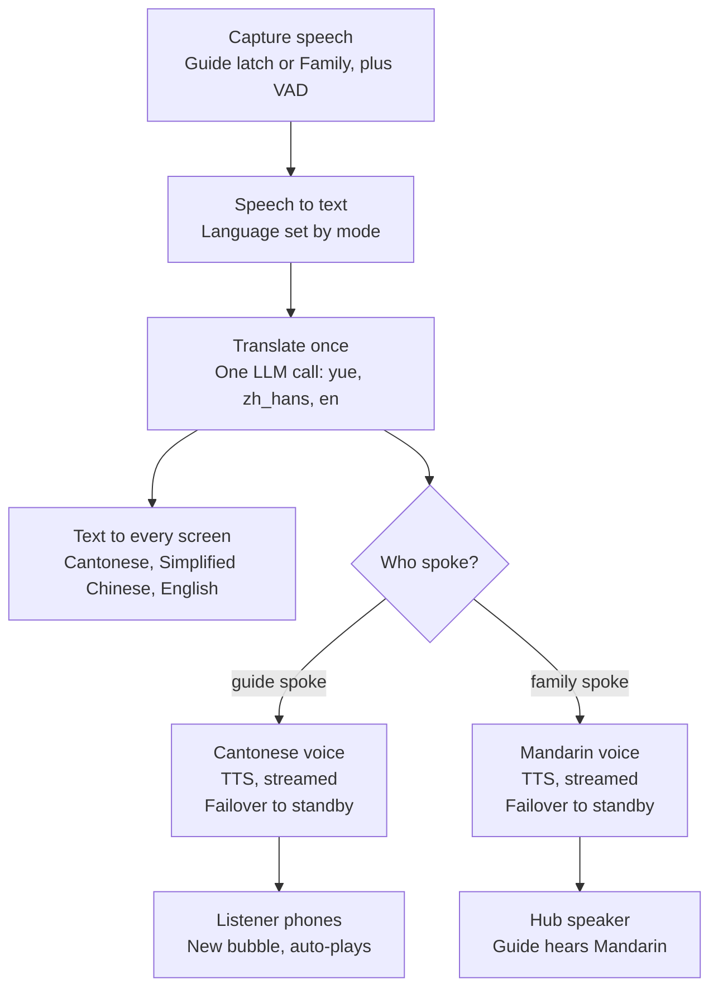
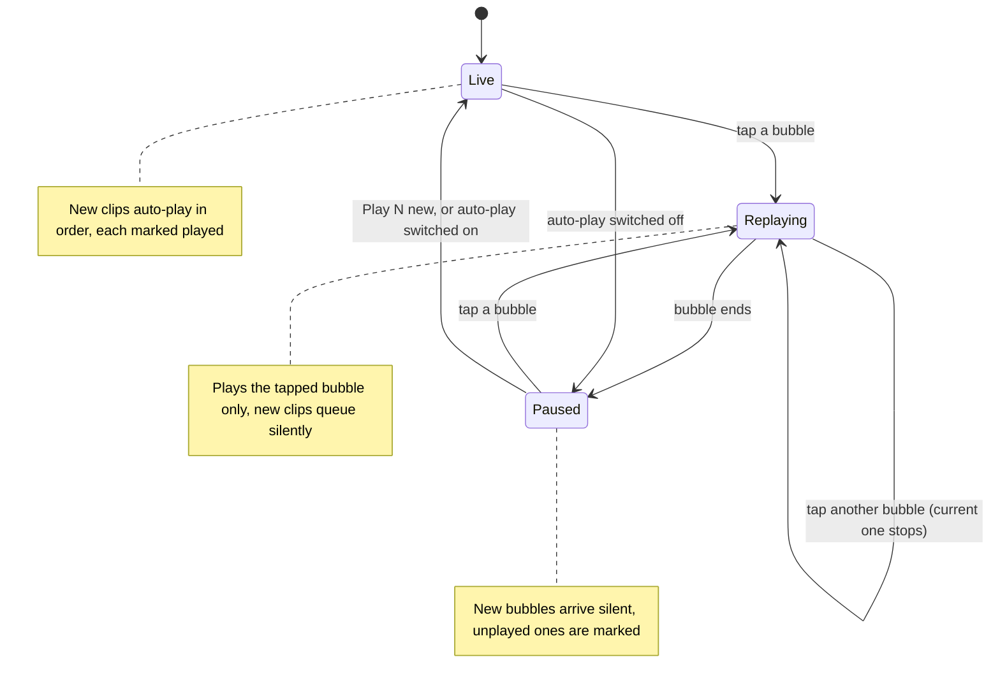
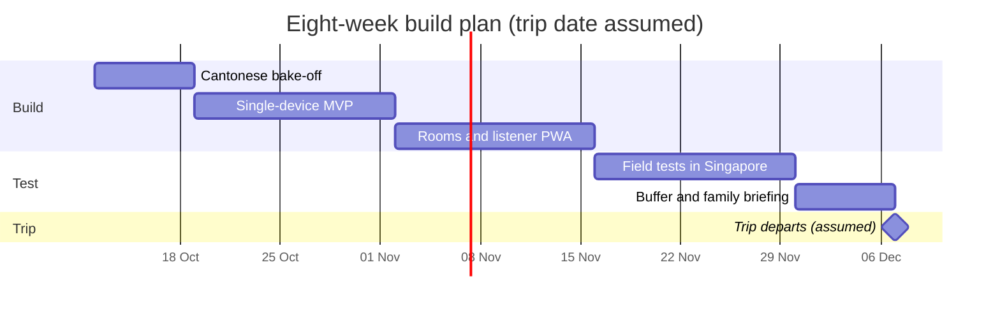

# Chongqing Family Translator — Technical Architecture & Design

Oct 7, 2026 · @Khoon Seng

## Overview

A voice-first web app turns a Mandarin-speaking tour guide into live Cantonese audio for five family members, and their replies into Mandarin for the guide, over Singapore roaming data in Chongqing.

Only two of the seven adults speak Mandarin. The app removes the need for them to interpret every conversation by hand.

**Goals**

- Speech is the main input; typing is available as a fallback.
- Every family listener hears Cantonese audio; the guide hears Mandarin audio.
- Large-font text sits beside the audio as a check on meaning.
- Works anywhere in Chongqing on SG roaming or a non-local-breakout eSIM.
- Field-tested and ready in about two months.

**Non-goals**

- Offline translation, or working on domestic Chinese networks and hotel Wi-Fi.
- Native iOS or Android apps; this is a mobile web app (PWA).
- Simultaneous interpretation. Consecutive interpretation, a few seconds behind the speaker, is the target.

**Success criteria**

- Translated audio starts within roughly 2–4 seconds of the speaker finishing a sentence.
- The in-laws pick the Cantonese voice and translations in a blind test.
- No bubble is lost after a dead zone or reconnect.
- Daily running cost stays in single-digit US dollars.

## Users, languages and channels

The app needs only two audio channels, Cantonese and Mandarin, plus text in three languages.

| Person | Speaks | Hears (audio) | Reads (text) | Device |
| --- | --- | --- | --- | --- |
| Guide | Mandarin | Mandarin, from the hub speaker | Simplified Chinese on the hub | Shared hub phone |
| In-laws | Cantonese | Cantonese (must-have, audio first) | Colloquial Cantonese, Traditional characters, large font | Own phone + earphones |
| Wife's siblings | Cantonese, English | Cantonese (must-have) | Cantonese or English | Own phone + earphones |
| Khoon Seng and wife | Mandarin, English, Cantonese | None needed | Optional | Operate the hub; human fallback |

Input language is chosen explicitly on the hub with **Guide** and **Family** talk buttons, because auto-detecting Mandarin versus Cantonese on short clips is unreliable. Family input can be Cantonese or English.

The Cantonese text is written as colloquial spoken Cantonese (粵語口語, e.g. 佢哋喺度等緊我哋), not formal written Chinese, so the same string reads naturally on screen and sounds natural when spoken.

## Hub phone and audio capture

The hub is Khoon Seng's own phone with no extra hardware; a clip-on mic is deferred until field tests show it is needed.

**Modes**

- **Guide** is a latch: one tap starts continuous listening, and voice-activity detection splits the guide's speech at natural pauses.
- To let family speak, tap **Family**; tap **Guide** again to return. The whole screen is tinted a different colour per mode so the current one is unmistakable.
- In Guide mode, segments the STT flags as not Mandarin, or as low confidence, are dropped. This only filters out family chatter; it never chooses the pipeline.

**Placement**

- In the car: phone in a dashboard or vent mount, bottom edge (main mic) toward the guide, radio off.
- On foot: phone held at chest height, within about 1 m of the guide.

**Hub phone rules**

- No Bluetooth earbuds connected to the hub phone; the phone may silently switch to their mic.
- Bring a car charger and power bank: continuous mic, screen wake lock and roaming data drain the battery fast.

**Clip-on mic (deferred)**

Decided at the weeks 6–7 field test by comparing transcripts: phone held at 1 m versus a clip-on worn by the person playing the guide. A clip-on only helps on the guide, not on the hub operator. If bought, it is a wireless kit whose receiver plugs into USB-C or Lightning, never Bluetooth, and the app simply uses the phone's default audio input.

## System architecture

A single Cloud Run service sits between one shared hub phone and five listener phones, calling external STT, translation and TTS APIs on their behalf.

&#91;embedded content: system architecture · hub, Cloud Run, providers, listeners\]

The hub sends speech in and plays Mandarin out; the orchestrator runs each sentence through the providers, stores the clip in Cloud Storage and pushes it to listeners over WebSockets.

Mermaid version, for the Markdown copy in the repo:

## Translation pipeline

Every sentence runs through one cascade: speech to text, a single translation call, then text-to-speech only for the listeners who need audio.

&#91;embedded content: translation pipeline · per sentence\]

Guide speech becomes Cantonese audio for the listeners; family speech becomes Mandarin audio from the hub speaker. Every screen gets text in all three languages.

Mermaid version, for the Markdown copy in the repo:

A single cascade replaces a hybrid of OpenAI's realtime translator plus a Cantonese cascade. One pipeline keeps the Cantonese and Mandarin channels in step and leaves one integration to maintain.

## Model and provider choices

Every stage sits behind a small adapter interface, and the winners are picked by a week-1 bake-off judged by the in-laws.

| Stage | Candidates | Standby / fallback | Chosen by |
| --- | --- | --- | --- |
| STT, Mandarin (guide) | OpenAI gpt-4o-mini-transcribe, Whisper large-v3 on Groq (paid tier), Google Cloud STT | Any of the others | Accuracy on Chongqing-accented Mandarin, noisy street audio |
| STT, Cantonese (family) | Google Cloud STT (Cantonese), Azure Speech zh-HK, OpenAI gpt-4o-transcribe | Any of the others | Accuracy on the in-laws' own recordings, incl. Cantonese–English code-switching |
| Translation LLM | A fast frontier-tier model: GPT mini class, Gemini Flash, Qwen | Second model from the list | Natural colloquial Cantonese output; no Mandarin grammar in Cantonese characters |
| TTS, Cantonese | Google Chirp 3 HD yue-HK (Preview, streaming, available in asia-southeast1) | Azure zh-HK neural voices (GA); Qwen3-TTS Cantonese voices | In-laws' blind listening test |
| TTS, Mandarin | Same providers as Cantonese | Same | Clarity for the guide |

**Translation call design.** One LLM call per sentence returns all three targets as JSON (`yue`, `zh_hans`, `en`), streamed so TTS can start on the first sentence. The prompt carries a glossary of Chongqing place and dish names (解放碑, 洪崖洞, 磁器口, 毛血旺) and only the last 2–3 utterances as context.

**Failover.** If a provider errors or is too slow on a sentence, the adapter retries that sentence on the standby. As a last resort the app shows the text and flags the hub operator to interpret.

**Ruled out.** OpenAI GPT-Realtime-Translate (no Cantonese output voice), conversational realtime models (an assistant, not an interpreter), Groq TTS (no Chinese voices) and Groq's free tier (request caps run out within hours of continuous use).

## Listener experience and playback rules

The listener screen works like a WhatsApp voice-note thread: audio first, large-font Cantonese text under every bubble, and any bubble replayable on its own.

**Bubbles**

- One bubble per speaker turn; each sentence inside it is its own audio clip.
- Tap a bubble to replay the whole turn; tap a sentence to replay just that sentence.
- The guide's original Mandarin shows in small text under each bubble, so Khoon Seng or his wife can check a confusing translation on the spot.
- Unplayed bubbles carry a visible marker, like unheard voice notes.

**Player states**

&#91;embedded content: listener player states, Live, Replaying, Paused\]

A replay plays only the tapped bubble and then stops in Paused; it never runs on into later bubbles. In Paused, new clips arrive silently so the listener can read instead of listen, until they tap **Play N new** or switch auto-play back on.

Mermaid version, for the Markdown copy in the repo:

- Tapping another bubble mid-replay stops the current one at once; two clips never overlap.
- Replays never re-call TTS: clips are cached on the phone (IndexedDB) and backed by Cloud Storage, so a replay works even in a tunnel.
- Each phone shows a tap-to-start screen on joining, which unlocks audio on iOS, and holds a screen Wake Lock while in a room.

## Hosting, networking and China access

The roaming SIM, not the cloud region, is what keeps the app reachable in Chongqing; the region is picked by a latency test.

**Connectivity**

- Every phone uses SG roaming or an eSIM confirmed to route outside China (no local breakout). Traffic exits in Singapore, so Google, OpenAI and Groq behave as they do at home.
- Wi-Fi stays off while the app is in use. Hotel and café Wi-Fi is on the domestic network, where Google domains are blocked whatever the region.
- Nothing is hosted in mainland China, which would need an ICP filing.

**Compute: Cloud Run**

- One service holds the Vue PWA, the FastAPI WebSocket endpoint and the pipeline, built as one container.
- `max-instances=1`, because room state lives in memory and a second instance would split the room.
- WebSocket connections are cut at the request timeout (60 minutes maximum); the client's reconnect-and-backfill logic handles it.
- Run at 1 vCPU. Below 1 vCPU, Cloud Run forces maximum concurrency to 1, which would allow only one WebSocket connection.
- Provider API keys live server-side in Secret Manager; phones never call providers directly.

**Region**

- Candidates: `us-central1` (inside the Cloud Storage free tier) and `asia-southeast1` (closest to the roaming exit and to Google's Cantonese voices).
- In week 1, deploy to both and measure time-to-first-audio from a Singapore phone. Keep the faster one.
- Cloud Run's free tier is a monthly spending discount per billing account, so it applies in either region.

**Storage: Cloud Storage**

- Each sentence's audio is saved as an Opus clip, plus a transcript log per room.
- Live clips travel inline over the WebSocket as binary frames; the bucket serves backfill after reconnects and catch-up fetches.
- A full trip is a few hundred MB, inside the 5 GB free allowance in US regions and pennies elsewhere.

**Joining a room.** The hub creates a room and shows a QR code holding a short-lived room token. Listeners scan it once, pick their language and stay joined for the day.

## Latency, rate limits and cost

The target is about 2–4 seconds from end of sentence to translated audio, at a few US dollars a day; tokens never pile up because every call is stateless.

**Latency budget (approximate, to be measured in week 1)**

| Step | Expected time |
| --- | --- |
| STT on one sentence | 0.5–1.5 s |
| Translation LLM, first sentence streamed | 0.5–1 s |
| TTS, first audio bytes | 0.5–1 s |
| Roaming path and region hop | 0.3–0.6 s |

**Rate limits**

- Each STT, translation and TTS request stands alone, so there is no growing context to exhaust. Translation passes only the last 2–3 utterances.
- Groq's free tier caps Whisper at 20 requests per minute and 2,000 per day, and its LLMs at about 1,000 requests per day. Continuous touring exhausts these within hours, so any Groq use needs the paid Developer plan.
- Three design choices keep request counts low: voice-activity detection on the phone so silence is never sent, sentence-sized chunks instead of fixed 2–3 second windows, and one LLM call returning all three languages.

**Cost (approximate, for about 3 hours of speech a day)**

| Item | Per day |
| --- | --- |
| STT (per-minute pricing, e.g. about US$0.003/min for gpt-4o-mini-transcribe) | Under US$1 |
| Translation LLM | Under US$0.50 |
| TTS for two voices | A few US dollars |
| Cloud Run and Cloud Storage | Near zero; WebSockets may exceed the free vCPU allowance by a dollar or two for the trip |

Prices were checked against public pricing pages in October 2026 and should be re-checked before the bake-off.

## Risks and mitigations

The biggest risks are audio capture and Cantonese quality, not hosting.

| Risk | Impact | Mitigation |
| --- | --- | --- |
| eSIM uses local breakout in China | App unreachable | Use SG roaming or a verified eSIM; keep a Qwen/Alibaba provider path as plan B |
| Phone joins hotel Wi-Fi | App blocked | Wi-Fi off at start of day; app shows a clear connection banner |
| Street noise, guide far from the hub | Poor STT | Hold the phone within about 1 m of the guide; add a clip-on mic for the guide only if the field test shows it is needed |
| Family chatter while Guide mode is latched | Junk bubbles transcribed as Mandarin | Listeners on earphones; drop segments flagged as not Mandarin or low confidence |
| Hub phone battery drains | Translation stops mid-tour | Car charger and power bank |
| Bluetooth earbuds connected to the hub | Phone silently switches to the earbud mic | Keep the hub phone free of Bluetooth audio devices |
| Chongqing-accented Mandarin | STT errors | Ask the guide for standard Putonghua; test on Chongqing-accented samples |
| Translation slips into Mandarin grammar | Cantonese sounds wrong to the in-laws | Colloquial-Cantonese prompt; blind bake-off of models |
| iOS audio unlock and screen lock | Listener hears nothing | Tap-to-start on join; Wake Lock API; test on the in-laws' actual phones |
| Tunnels and dead zones | Missed bubbles | Reconnect and backfill from the last utterance id |
| Cantonese TTS still in Preview at Google | Voice outage | Adapter failover to Azure zh-HK; last resort text plus human interpreting |
| Mandarin vs Cantonese auto-detection | Wrong pipeline | Explicit Guide and Family modes on the hub |
| Listener phones playing aloud | Echo and feedback into the hub mic | Earphones for every listener |

## Eight-week build plan

Seven weeks of build and field testing start on 12 October, leaving the final week as buffer before an assumed early-December departure.

&#91;embedded content: eight-week build plan, by week\]

Mermaid version, for the Markdown copy in the repo:

1. **Week 1, Cantonese bake-off.** Run 10–15 recorded Mandarin narration sentences through 2–3 translation models and 2–3 Cantonese voices, blind, for the in-laws to judge. Score each Cantonese STT on their recorded questions. Deploy a test service to both regions and confirm the eSIM's routing.
2. **Weeks 2–3, single-device MVP.** The hub records, shows text and plays audio, with provider adapters in place.
3. **Weeks 4–5, rooms and listener PWA.** QR join, WebSocket fan-out, bubbles, player states, on-phone cache, reconnect and backfill.
4. **Weeks 6–7, field tests in Singapore.** The family uses their own phones in noisy places such as hawker centres and the MRT, with someone acting as the Mandarin guide. Compare transcripts from the phone held at 1 m against a clip-on worn by the "guide" to decide whether to buy a mic.
5. **Week 8, buffer.** Fixes, then briefing the family on joining a room and using replay.

## Open decisions

Seven decisions remain; most close after the week-1 bake-off. Decided on 7 Oct: the hub is the owner's phone, with Guide mode latching into continuous listening.

- [ ] Trip dates and the final roaming plan or eSIM provider
- [ ] Whether the guide will be driving or seated separately (affects phone placement in the car)
- [ ] Cloud Run region: `us-central1` or `asia-southeast1`, after the latency test
- [ ] Winning STT, translation model and Cantonese voice, after the bake-off
- [ ] New-bubble cue while paused: vibration on Android, chime or animation on iOS
- [ ] Clip-on mic for the guide: only if the weeks 6–7 field test shows phone-only is not enough
- [ ] Whether English text shows by default for the wife's siblings
