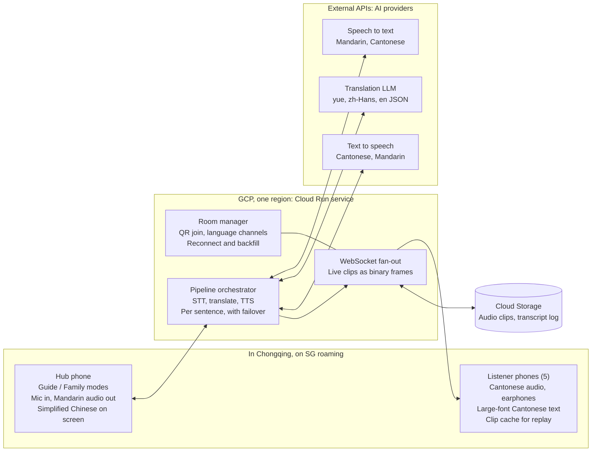
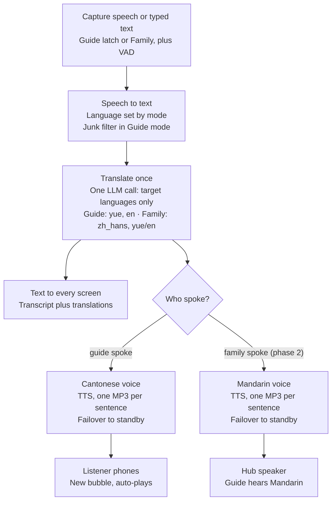
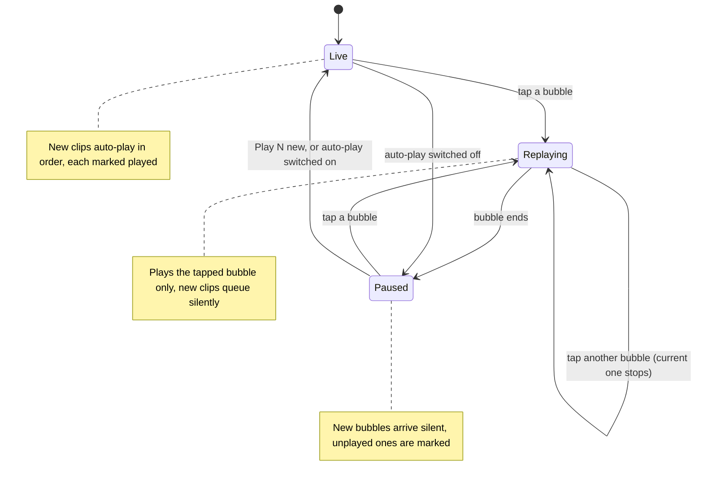

# Chongqing Family Translator — Technical Architecture & Design

Oct 7, 2026 · @Khoon Seng

## Overview

A voice-first web app turns a Mandarin-speaking tour guide into live Cantonese audio for five family members, and their replies into Mandarin for the guide, over Singapore roaming data in Chongqing.

Only two of the seven adults speak Mandarin. The app removes the need for them to interpret every conversation by hand.

**Goals**

- Speech is the main input; typing is available as a fallback.
- Every family listener hears Cantonese audio; the guide hears Mandarin audio.
- Large-font text sits beside the audio as a check on meaning.
- Works anywhere in Chongqing on SG roaming or a non-local-breakout eSIM.
- Field-tested and ready in about two months.

**Non-goals**

- Offline translation, or working on domestic Chinese networks and hotel Wi-Fi.
- Native iOS or Android apps; this is a mobile web app (PWA).
- Simultaneous interpretation. Consecutive interpretation, a few seconds behind the speaker, is the target.

**Build order**

- **Phase 1 (trip-critical): guide → family.** Mandarin speech, or Mandarin typed on the hub, becomes Cantonese audio and large-font Cantonese text on every listener phone. English text follows if time permits.
- **Phase 2: family → guide.** Family mode (Cantonese or English), Mandarin audio from the hub speaker, half-duplex capture, and typing on listener phones. It starts only after phase 1 passes its field test. If it slips past the trip, Khoon Seng and his wife interpret replies, as they would anyway.

**Success criteria**

- Translated audio starts within roughly 2–4 seconds of the speaker finishing a sentence.
- The in-laws pick the Cantonese voice and translations in a blind test.
- No bubble is lost after a dead zone or reconnect.
- Daily running cost stays in single-digit US dollars.

## Users, languages and channels

The app needs only two audio channels, Cantonese and Mandarin, plus text in three languages.

| Person | Speaks | Hears (audio) | Reads (text) | Device |
| --- | --- | --- | --- | --- |
| Guide | Mandarin | Mandarin, from the hub speaker | Simplified Chinese on the hub | Shared hub phone |
| In-laws | Cantonese | Cantonese (must-have, audio first) | Colloquial Cantonese, Traditional characters, large font | Own phone + earphones |
| Wife's siblings | Cantonese, English | Cantonese (must-have) | Cantonese or English | Own phone + earphones |
| Khoon Seng and wife | Mandarin, English, Cantonese | None needed | Optional | Operate the hub; human fallback |

Input language is chosen explicitly on the hub with **Guide** and **Family** talk buttons, because auto-detecting Mandarin versus Cantonese on short clips is unreliable. Family input can be Cantonese or English in a single Family mode: speech-to-text receives both `yue-Hant-HK` and `en-US`, and both go through the same pipeline. Typed text may be language-detected; the explicit-mode rule covers speech only.

All family phones are iPhones (iPhone 14 Pro or later, iOS 26.6.2 or later), so every phone-side decision is made for iOS Safari first.

The Cantonese text is written as colloquial spoken Cantonese (粵語口語, e.g. 佢哋喺度等緊我哋), not formal written Chinese, so the same string reads naturally on screen and sounds natural when spoken.

## Hub phone and audio capture

The hub is a spare phone the guide carries on a lanyard, with its own eSIM or physical SIM. Khoon Seng's own phone is the fallback hub. A clip-on mic is deferred until field tests show it is needed.

Why not Khoon Seng's phone: on iOS, Safari stops the mic as soon as he switches to the camera, WeChat or maps, and he needs those apps during the tour. Sharing his Personal Hotspot with the spare phone was rejected because it drains his battery and heats the phone; the spare phone gets its own data line.

**Modes**

- **Guide** is a latch: one tap starts continuous listening, and voice-activity detection (Silero VAD) splits the guide's speech at short pauses (about 0.6–0.8 s), with each chunk capped at 15 seconds. A pause ends a chunk, never the listening session.
- To let family speak (phase 2), tap **Family**; tap **Guide** again to return. The whole screen is tinted a different colour per mode so the current one is unmistakable.
- The hub also takes typed Mandarin, which skips speech-to-text.

**Junk filter (Guide mode)**

With the mic open all day, the hub also hears family chatter, other guides, vendors and the car radio. Speech-to-text, told to expect Mandarin, would turn all of it into garbled transcripts that play as nonsense Cantonese. The filter drops such speech before translation. It never chooses the pipeline; Guide mode stays Guide mode.

1. **Mic close to the guide.** The spare phone on the guide's lanyard (or a clip-on) makes the guide far louder than anyone else. This is the main defence and the only one that helps against other Mandarin speakers nearby.
2. **Drop sentences written in Cantonese** (decided 23 Oct). Speech-to-text receives both `cmn-Hans-CN` and `yue-Hant-HK`. With Mandarin alone, Chirp 3 rewrote Cantonese speech as fluent Mandarin, so chatter would pass as guide speech. With both, Cantonese words survive in the text (我哋, 唔, 喺). The transcript is split into sentences, and a sentence is dropped when Cantonese-only characters (哋, 唔, 喺, 嘅, 咗, 冇, 佢, 嚟, 啲, 嘢, 嗰, 乜, 囉, 喎, 咩, 咁) make up more than a set share of it. The bake-off sets that share from how often it drops real guide sentences versus family chatter; the starting point is 15–20%. A Cantonese remark in a pause becomes its own sentence and is dropped, while a guide sentence with one stray 唔 survives. Chirp 3's language labels can't be used: in the smoke test it labelled Cantonese speech as Mandarin in every language order.
3. **Drop fragments.** Very short transcripts and filler (嗯, 啊, 對) are discarded.

Chirp 3 returns no usable confidence score, so confidence is not part of the filter.

**Placement**

- Spare hub phone: on a lanyard at the guide's chest, bottom edge (main mic) up.
- Fallback, Khoon Seng's phone: in the car, in a dashboard or vent mount with the bottom edge toward the guide and the radio off; on foot, held at chest height within about 1 m of the guide. Switching to another app stops capture; on return the hub shows a large "Tap to resume listening" banner, and speech in between is lost.

**Hub phone rules**

- **Half-duplex:** the hub pauses mic capture while it plays any audio and resumes when playback ends, so it never hears its own Mandarin output as the guide speaking. Browser echo cancellation (`echoCancellation: true`) stays on as a second layer, not as the main defence.
- No Bluetooth earbuds connected to the hub phone; the phone may silently switch to their mic.
- Bring a car charger and power bank: continuous mic, screen wake lock and roaming data drain the battery fast.

**Clip-on mic (deferred)**

Decided at the weeks 6–7 field test by comparing transcripts: the spare hub phone on the lanyard versus a clip-on worn by the person playing the guide. A clip-on matters most if there is no spare phone and the hub stays about 1 m away. If bought, it is a wireless kit whose receiver plugs into USB-C or Lightning, never Bluetooth, and the app simply uses the phone's default audio input.

**The spare hub phone (decided 13 Oct, subject to getting one)**

- **Benefit:** the mic sits at the guide's mouth rather than about 1 m away, which should improve STT in noisy places, strengthens the junk filter and may remove the need for a clip-on mic.
- **Hub behaviour:** stays latched in Guide mode; the guide never switches modes. In phase 2, Mandarin replies play from its speaker, since the guide wears no earphones.
- **Family replies move to their own phones (phase 2):** the listener screen gains a hold-to-talk button (Cantonese or English) and a text box, replacing the Family button on the hub.
- **The phone:** any spare iPhone or Android phone with its own eSIM or physical SIM routed through SG roaming (not Khoon Seng's hotspot). It is locked to the app with Guided Access (iOS) or App Pinning (Android), carries no personal accounts, and comes with a lanyard and a power bank.

## System architecture

A single Cloud Run service sits between one shared hub phone and five listener phones, calling external STT, translation and TTS APIs on their behalf.

&#91;embedded content: system architecture · hub, Cloud Run, providers, listeners\]

The hub sends speech in and plays Mandarin out; the orchestrator runs each sentence through the providers, stores the clip in Cloud Storage and pushes it to listeners over WebSockets.

Mermaid version, for the Markdown copy in the repo:

## Translation pipeline

Every sentence runs through one cascade: speech to text, a single translation call, then text-to-speech only for the listeners who need audio.

&#91;embedded content: translation pipeline · per sentence\]

Guide speech becomes Cantonese audio for the listeners; family speech (phase 2) becomes Mandarin audio from the hub speaker. Every screen gets text: the transcript in the source language plus the translated languages.

Mermaid version, for the Markdown copy in the repo:

A single cascade replaces a hybrid of OpenAI's realtime translator plus a Cantonese cascade. One pipeline keeps the Cantonese and Mandarin channels in step and leaves one integration to maintain.

## Model and provider choices

Google Cloud is the primary provider for every stage, each stage has a fallback from another provider, and the week-1 bake-off judged by the in-laws confirms or overturns each choice.

| Stage | Primary | Fallback | Notes |
| --- | --- | --- | --- |
| STT, Mandarin, Cantonese and English | Google Speech-to-Text V2, `chirp_3` model, **streaming** (target, confirmed by the week-1 test; sync meanwhile): cmn-Hans-CN (GA), yue-Hant-HK (Preview), en-US. Runs only in the `us` and `eu` multi-regions. The glossary is also passed as phrase biasing | One OpenAI model run on the saved audio segments: `gpt-4o-transcribe` (US$0.006/min) or `gpt-transcribe` (US$0.0045/min), chosen by the bake-off | Bake-off scores all candidates on Chongqing-accented, fast narration, and checks that the fallback doesn't return Mandarin-style text for Cantonese speech. Chirp 3 costs US$0.016/min after 60 free minutes a month, so the trip's ~900 minutes cost about US$13 or come out of Google's free-trial credit |
| Translation LLM | Decided by 15 Nov using the rule below: Gemini 3.6 Flash on **Vertex AI**, or Groq | The other of the two. Groq candidates: `qwen/qwen3.8-27b` (Preview) and `openai/gpt-oss-120b` (Production) | All candidates pass the same blind test and colloquial-marker check, in both directions |
| Translation, bake-off candidate | Google Cloud Translation v3, standard (NMT) model, text only: `zh-CN` → `yue`, `en`; `yue`, `en` → `zh-CN` | Role decided after the bake-off: none, last-resort fallback, or main translator | Same blind test and colloquial-marker check as the LLMs. See "Google Cloud Translation" below |
| TTS, Cantonese and Mandarin | Google Chirp 3 HD voices (Cantonese yue-HK in Preview), one non-streaming request per sentence returning MP3 | Google's older non-Chirp voices | In-laws' blind listening test picks the voices. MP3 because it plays on every iPhone; Ogg Opus support in iOS Safari is unconfirmed, and per-sentence clips gain little from streaming |
| Pause detection | Silero VAD in the browser (`@ricky0123/vad-web`) | None | 15-second chunk cap; the server splits long transcripts at punctuation |

**Adapters and credentials.** The translation adapter is a single OpenAI-compatible client, configured per provider with a base URL, model and key, so switching between Gemini and Groq is a config change. STT and TTS adapters are provider-specific. On Cloud Run, Google's speech APIs and Gemini on Vertex AI authenticate with the service account, so they need no API keys; only the Groq and OpenAI keys live in Secret Manager. Groq's lineup changes quickly (Qwen3.6-27B was replaced by Qwen3.8-27B within weeks), so model IDs live in config and are re-checked before the trip.

**Translation call design.** One LLM call per sentence returns the target languages as JSON, never the source language: guide speech returns `yue` (and `en` once English is added), and family speech in phase 2 returns `zh_hans` plus whichever of `yue` or `en` wasn't spoken. The transcript itself is the source-language text, so the model can't reword what was said, and fewer output tokens means less waiting. The field TTS needs comes first and is streamed, so TTS can start as soon as it closes. The prompt carries a glossary of Chongqing place and dish names (解放碑, 洪崖洞, 磁器口, 毛血旺) and only the last 2–3 utterances as context.

**Sampling settings.** Temperature and top-p are set per model in config. They change how the model picks words: low means consistent and literal, high means more varied wording with more risk of errors. Gemini 3 stays at temperature 1.0, because Google strongly recommends its default and warns that lower values can cause looping or worse output. Qwen and gpt-oss run in the bake-off at 0.2 and at their makers' recommended values (Qwen 0.7 with top-p 0.8; gpt-oss 1.0 with top-p 1.0), and the better-scoring setting is kept. Cloud Translation, Chirp 3 and the voices have no such settings.

**Reasoning off.** Reasoning ("thinking" before answering) is switched off on the translation model, or set to its lowest level where it can't be switched off (`gpt-oss-120b`: low), through per-provider config. For one sentence with a glossary it rarely improves quality and adds one to several seconds. Speech-to-text and text-to-speech have no reasoning setting and are unaffected. The bake-off runs each model both ways; if "off" loses noticeably in the blind test or the colloquial-marker score, the lowest setting that wins is used.

**Google Cloud Translation (bake-off candidate, added 14 Oct).** This is Google's translation API, the same family as the Google Translate app, but it takes **text only**. It can replace only the translation step; speech-to-text, pause detection and text-to-speech stay as designed. The app's early cut-off after short pauses comes from the app's own listening logic and doesn't apply to the API.

- **Strengths:**
  - Meets zero data retention by default: text is "held briefly in-memory" and never used for training, so no exception request is needed.
  - Typically answers in a few hundred milliseconds, faster than an LLM.
  - Priced per character with a monthly free allowance (re-check before the bake-off).
  - Authenticates with the service account, so no key is needed.
  - Its failure modes are unrelated to Groq's caps and Vertex AI's 429 errors.
- **Limitations:**
  - Cantonese is supported only by the standard (NMT) model, not by Google's Translation LLM, so the output style can't be steered toward colloquial Cantonese.
  - Each sentence is translated without the previous 2–3 sentences as context.
  - One call per target language.
  - Glossaries must be uploaded from a Cloud Storage bucket, and the docs don't confirm they work with Cantonese.
- **What it would take to adopt:** a provider-specific translation adapter alongside the OpenAI-compatible LLM client, and rewording hard rules 4 and 6, which assume an LLM. Rules change only if it wins a role, and with the owner's approval.
- **Expected role:** the last-resort fallback after Gemini and Groq. It becomes the main translator only if its Cantonese matches the best LLM in the blind test. If its Cantonese comes out formal, it is used for family → guide only, or not at all.

**Failover.** If a provider errors or is too slow on a sentence, the adapter retries that sentence on the standby. As a last resort the app shows the text and flags the hub operator to interpret (unless Cloud Translation is adopted as the last fallback).

**Ruled out.** OpenAI GPT-Realtime-Translate (no Cantonese output voice), conversational realtime models (an assistant, not an interpreter), Groq TTS (no Chinese voices, and Groq does not host Qwen3-TTS), the Gemini API free tier in AI Studio (prompts may be used to improve Google's models, so it fails ZDR), Qwen3-TTS on Alibaba Model Studio (ZDR only for enterprise customers, and flagged content can be kept for up to 2 years) and Azure Speech (kept to one cloud provider). OpenAI's API has no free tier, so it serves only as a paid STT fallback. OpenAI `gpt-live-transcribe` (US$0.017/min) streams, but only through the Realtime API, which keeps data for 30 days for abuse monitoring unless OpenAI approves zero data retention. A streaming fallback would also add little: it only covers a Chirp 3 outage, and the file-based fallback answered a 5-second clip in about 1–2 s. It would be reconsidered only as a Chirp 3 replacement, and only if OpenAI confirms zero retention in writing.

**Streaming speech-to-text (target design, decided 23 Oct; confirmed by the week-1 test)**

Non-streaming Chirp 3 took about 3 s to transcribe a 5-second clip, on top of about 0.7 s of pause detection and the upload: too slow for the 2–4 s target. Streaming transcribes while the guide talks. Our design never lost speech at pauses, because Guide mode stays latched; streaming is about speed and whole sentences.

- **Hub:** sends speech audio over its WebSocket while Guide is latched. The browser VAD still holds back long silences, which saves money because Chirp 3 bills per second of audio. Its pauses also cut the saved audio into segments for the fallback.
- **Server:** keeps one Chirp 3 stream open. Google's limits: a stream lasts at most 5 minutes (the server starts a new one at a pause before then), each message carries at most 25 KB, and audio must arrive at real-time pace. Chirp 3's final transcripts are split into sentences at punctuation, filtered (junk filter) and translated one by one.
- **Fallback:** if the stream fails, the saved segments go to the OpenAI fallback model as files.
- **First synthetic test (23 Oct, laptop in Singapore):** each sentence's final transcript arrived 0.8–1.0 s after its audio, about 1.7–2.0 s after the speaker stopped, because Chirp 3 first waits for a short silence. "Standard" endpointing kept sentences whole; "short" split mid-word ("排队可能要40分" / "钟左右"), so standard is the default.
- **Still to confirm** with real guide recordings (`bakeoff/02b_stt_streaming.py`): accuracy against the sync runs, delay on real narration, and how Chirp 3 splits continuous speech. Hard rule 9 is rewritten once these hold.

## Data retention (ZDR) and the primary translation model

Every provider in the stack must keep zero data from the family's conversations; two items depend on Google approving or confirming them, so both requests go in during week 1.

| Provider | ZDR status | Action needed |
| --- | --- | --- |
| Google Speech-to-Text (sync) | Met by default: audio processed in memory, nothing stored | Never opt into data logging; never use the async (batch) endpoint |
| OpenAI transcription (STT fallback) | Met by default: no training, no abuse-monitoring or application-state retention on this endpoint | None |
| Gemini on Vertex AI | Achievable, not automatic | Disable in-memory caching on the project; request Google's abuse-monitoring exception; confirm Gemini 3.6 Flash qualifies |
| Groq | Self-serve | Switch on Zero Data Retention in Data Controls |
| Google Text-to-Speech | Not yet confirmed in writing | Ask Google support, or check the Cloud data processing terms |

**Our own app: logs follow ZDR, storage is a deliberate exception**

- Cloud Run logs hold request IDs, timings and errors only, never transcripts, translations or audio.
- Cloud Storage keeps clips and transcripts for **30 days** (decided 13 Oct), so Khoon Seng has time to download anything the family wants to keep. This is our own storage, not a provider's, and the exception was approved explicitly.
  - A lifecycle rule deletes objects after 30 days. Lifecycle deletion runs on a schedule, so an object can outlive its age by up to about a day.
  - Soft delete is set to 0 on the bucket. Otherwise Cloud Storage keeps deleted objects for another 7 days by default, including lifecycle deletions.
  - The bucket is private. Clips reach phones only through the app, checked against the room token, never as public links.
- Listener phones keep their IndexedDB cache; there is no end-of-day clear. Saving or exporting a bubble and browsing previous days come after the trip; until then, downloads are done manually from the bucket.

**Choosing the primary translation model**

Groq and Gemini on Vertex AI are both configured, each as the other's fallback, because their failures are unrelated: Groq fails by hitting fixed caps, Vertex AI by a busy shared pool returning 429 errors.

- Gemini is primary if Google grants the abuse-monitoring exception **and** Gemini wins the bake-off.
- Otherwise Groq is primary, using whichever Groq model wins the bake-off. If Qwen3.8-27B and gpt-oss-120b are close, gpt-oss-120b wins because it is a Production model, not Preview.
- Deadline: end of week 5, **15 Nov 2026**. Whatever the status is then is what the trip uses, so the field tests run on the final stack.

**If Google cannot confirm Text-to-Speech retention,** no ZDR-verified Cantonese voice remains among the providers considered. That would need a new search for a ZDR-compliant Cantonese TTS provider, or a decision to accept Google's terms.

## Listener experience and playback rules

The listener screen works like a WhatsApp voice-note thread: audio first, large-font Cantonese text under every bubble, and any bubble replayable on its own.

**Chunks, sentences and bubbles**

Three units work at different levels, so the 2-second bubble rule never delays translation.

| Unit | Ends when | Who sees it |
| --- | --- | --- |
| Chunk (sent by the hub) | A short pause (about 0.6–0.8 s, tuned in testing) or the 15 s cap | Nobody; it exists for speed |
| Sentence (one audio clip) | The server splits the transcript at punctuation | Tap a sentence to replay it |
| Bubble (one voice note) | A pause longer than 2 s, a mode switch, or the bubble reaching 45 s of audio or 6 sentences | Tap a bubble to replay it |

The hub sends the pause length before each chunk, and the server decides where bubbles break.

**Keeping up with fast speech**

A guide who talks fast and without pauses produces Cantonese audio faster than listeners can hear it, so they drift further behind. When several clips are queued, the server raises Chirp 3 HD's `speaking_rate` to about 1.1–1.25; the threshold and rate are tuned in field tests.

**Bubbles**

- Each bubble groups up to 6 sentences; each sentence inside it is its own audio clip.
- Listeners can type replies on their own phones (phase 2).
- Tap a bubble to replay the whole turn; tap a sentence to replay just that sentence.
- The guide's original Mandarin shows in small text under each bubble, so Khoon Seng or his wife can check a confusing translation on the spot.
- Unplayed bubbles carry a visible marker, like unheard voice notes.

**Player states**

&#91;embedded content: listener player states, Live, Replaying, Paused\]

A replay plays only the tapped bubble and then stops in Paused; it never runs on into later bubbles. In Paused, new clips arrive silently so the listener can read instead of listen, until they tap **Play N new** or switch auto-play back on.

Mermaid version, for the Markdown copy in the repo:

- Tapping another bubble mid-replay stops the current one at once; two clips never overlap.
- Replays never re-call TTS: clips are cached on the phone (IndexedDB) and backed by Cloud Storage, so a replay works even in a tunnel.
- Each phone shows a tap-to-start screen on joining, which unlocks audio on iOS, and holds a screen Wake Lock while in a room.

## Hosting, networking and China access

The roaming SIM, not the cloud region, is what keeps the app reachable in Chongqing; everything runs in `us-central1`.

**Connectivity**

- Every phone uses SG roaming or an eSIM confirmed to route outside China (no local breakout). Traffic exits in Singapore, so Google, OpenAI and Groq behave as they do at home.
- Wi-Fi stays off while the app is in use. Hotel and café Wi-Fi is on the domestic network, where Google domains are blocked whatever the region.
- Nothing is hosted in mainland China, which would need an ICP filing.

**Compute: Cloud Run**

- One service holds the Vue PWA, the FastAPI WebSocket endpoint and the pipeline, built as one container.
- `max-instances=1`, because room state lives in memory and a second instance would split the room.
- WebSocket connections are cut at the request timeout (60 minutes maximum); the client's reconnect-and-backfill logic handles it.
- Run at 1 vCPU. Below 1 vCPU, Cloud Run forces maximum concurrency to 1, which would allow only one WebSocket connection.
- Provider API keys live server-side in Secret Manager; phones never call providers directly.
- Only a phone that has entered the hub PIN can send audio or text, so a leaked link or photographed QR code can't run up provider costs or post into the room.
- `min-instances=1` from 15 Dec to 23 Dec 2026, so the first sentence of the day never waits for a cold start; set back to 0 on 24 Dec. At all other times the service scales to zero.

**Region: `us-central1` (decided 13 Oct)**

- Chirp 3 speech-to-text runs only in the `us` and `eu` multi-regions. Hosting in Singapore (`asia-southeast1`) would still cross the Pacific for speech-to-text and, for Groq, translation, so latency would be roughly a tie.
- `us-central1` keeps Cloud Run, Cloud Storage, Vertex AI and text-to-speech in one place, inside the Cloud Storage free allowance, and new Google models usually arrive there first.
- Phones still connect through Google's edge in Singapore; the crossing to Iowa runs on Google's own network.
- No two-region test. Week 1 measures time-to-first-audio in `us-central1` only; moving region later is a redeploy.

**Storage: Cloud Storage**

- Each sentence's audio is saved as an MP3 clip, plus a transcript log per room. Everything is kept 30 days (see "Data retention").
- Live clips travel inline over the WebSocket as binary frames; the bucket serves backfill after reconnects and catch-up fetches.
- A full trip is a few hundred MB, inside the 5 GB free allowance in US regions and pennies elsewhere.

**Hub upload.** The hub sends raw 16 kHz PCM, about 350 MB a day for 3 hours of speech, which avoids an audio-encoder dependency. Data is not a constraint on Khoon Seng's phone (Singtel GOMO includes 60 GB of roaming data a month); the spare hub phone's eSIM or SIM needs about 2 GB for the 5-day trip.

**One fixed room, one active hub**

- There is a single fixed room. Listeners scan its QR code once, pick their language and stay joined.
- Exactly one phone is the active hub at a time; two hubs would capture the guide twice and duplicate bubbles.
- **Hub PIN:** a short code entered once on any phone allowed to act as hub; the phone remembers it. Listeners never need it.
- **Become hub:** if the hub's battery dies or it drops off, any phone with the PIN (Khoon Seng's, his wife's, a replacement) taps **Become hub**. The server moves the hub role to that phone, and bubble history carries on unbroken. If the old hub comes back, it shows "Another phone is the hub" and works as a listener until someone takes the role back.
- **Hub offline:** if the hub is unreachable for more than about 20 seconds, listener phones show a "Hub offline" banner so someone knows to take over.

## Latency, rate limits and cost

The target is about 2–4 seconds from end of sentence to translated audio, at a few US dollars a day; tokens never pile up because every call is stateless.

**Latency budget (approximate, to be measured in week 1)**

| Step | Expected time |
| --- | --- |
| VAD waits for the pause that ends a chunk (non-streaming only) | 0.6–0.8 s |
| STT on one sentence, non-streaming (measured 23 Oct from a Singapore laptop: ~3 s for a 5 s clip) | ~3 s |
| STT, streaming: end of speech to final transcript (first synthetic test, 23 Oct) | ~1.7–2.0 s |
| Translation LLM, first sentence streamed | 0.5–1 s |
| TTS, first audio bytes | 0.5–1 s |
| Roaming path and the Singapore–`us-central1` crossing | 0.3–0.6 s |

**Rate limits**

- Each STT, translation and TTS request stands alone, so there is no growing context to exhaust. Translation passes only the last 2–3 utterances.
- Groq's free tier caps Whisper at 20 requests per minute and 2,000 per day, and its LLMs at about 1,000 requests per day. Continuous touring exhausts these within hours, so any Groq use needs the paid Developer plan.
- Three design choices keep request counts low: voice-activity detection on the phone so silence is never sent, sentence-sized chunks instead of fixed 2–3 second windows, and one LLM call returning all three languages.

**Cost (approximate, for about 3 hours of speech a day)**

| Item | Free allowance | Estimate for the 5-day trip (19–23 Dec) |
| --- | --- | --- |
| STT: Google Chirp 3 | 60 minutes a month, then US$0.016 per minute | About 900 minutes, roughly US$14 |
| Translation, if Gemini on Vertex AI is primary | None on Vertex AI | US$1.50 per million input and US$7.50 per million output tokens: roughly US$4–5 a day |
| Translation, if Groq is primary | Free plan too small for touring; Developer plan | Well under US$1 a day |
| TTS: Google Chirp 3 HD | 1 million characters a month, then US$30 per million | About 200,000 characters, inside the free allowance |
| Cloud Run, Cloud Storage, egress | Free tiers | Near zero to a few dollars, including the always-on instance from 15 to 23 Dec |

Prices were checked against public pricing pages in October 2026 and should be re-checked before the bake-off.

## Free tiers, paid plans and billing

Nothing needs a subscription: almost every service is pay-as-you-go with a free allowance, and only Groq has a plan switch. Development runs on free allowances; everything moves to its trip configuration at the start of week 6.

| Component | Development (weeks 1–5) | Production (field tests and trip) |
| --- | --- | --- |
| Groq | Free plan with ZDR on: 30 requests/min, 1,000/day, 8,000 tokens/min, 200,000 tokens/day (about 220 translations a day) | Developer plan; free caps would run out within the first hour of narration |
| Gemini | Vertex AI from day one (AI Studio's free tier fails ZDR); cents | Vertex AI pay-as-you-go, about US$4–5 a day as primary |
| STT (Google Chirp 3) | 60 free minutes a month, then US$0.016/min; a few dollars | About US$14 for the trip |
| STT fallback (OpenAI) | Small prepaid credit, used only to test failover | Same credit |
| TTS (Google Chirp 3 HD) | Free (1 million characters a month) | Free (about 200,000 characters) |
| Cloud Storage | Free in `us-central1` (5 GB-months) | 30 days of MP3 clips and transcripts, a few hundred MB: free |
| Cloud Run | Free (2 million requests a month, plus compute allowance) | Near free; a few dollars for WebSocket time and the always-on instance from 15 to 23 Dec |
| IndexedDB | Built into the browser; free | Same |
| Secret Manager | Free (6 active secret versions, 10,000 accesses a month) | Same |
| Artifact Registry | Free up to 0.5 GB; cleanup policy keeps only the last 2 images | Same |
| Cloud Build and Cloud Logging | Free (120 build-minutes a day; 50 GiB of logs a month) | Same |
| Network egress to phones | Negligible | About 1 GB for the trip, under a dollar |
| Silero VAD, Vue, FastAPI | Open source; free | Same |

**Billing steps**

1. **Day one:** enable billing on the Google Cloud project and set a budget alert of about US$20 a month (alerts warn; they don't cap spending). Use Vertex AI for Gemini, and Groq's free plan with ZDR on.
2. **Start of week 6:** upgrade Groq to the Developer plan, top up the OpenAI credit and raise the budget alert to about US$80, so the field tests run on the exact trip configuration.
3. **15 Dec:** set Cloud Run `min-instances=1`. **24 Dec:** set it back to 0.

**Expected totals:** about US$5–10 for development; for the 5-day trip, about US$40–45 with Gemini as primary or US$20–25 with Groq as primary. A new Google Cloud billing account may get US$300 of free-trial credit for 90 days, but eligibility excludes anyone who has had a Google Cloud trial or paid account before, and a trial account stops its resources when the trial ends unless upgraded. Upgrade before the trip, and budget as if the credit isn't there.

**App-side spending alert.** The server totals each day's speech-to-text minutes, translation tokens and text-to-speech characters and shows an estimated daily cost on phones that have entered the hub PIN, with a warning banner above US$12 a day. It never pauses or stops translation: Khoon Seng may not have the hub when the guide is carrying it. The guide's hub screen never shows it. Google's budget email alerts stay on as a second layer.

## Alternatives considered

No existing tool delivers private Cantonese audio to each person's own phone, so the app is being built; two free tools stay on as fallbacks.

| Tool | What it does well | Why it was not chosen |
| --- | --- | --- |
| Google Translate (conversation mode) | Cantonese text and speech; works on SG roaming | One shared device, two people at a time; no private audio per person; stops listening after pauses shorter than 1 second (tested 14 Oct 2026); no API |
| Google Cloud Translation API | Text translation including Cantonese; zero data retention by default; fast and cheap | Text only, so it can't be a whole solution. Tested in the bake-off as the translation step (see "Model and provider choices") |
| Google Media Translation API | Was streaming speech translation | Shut down after 1 July 2024; Google points to Speech-to-Text plus Cloud Translation instead |
| Microsoft Translator Converse | Was the closest multi-device group feature | Retired on 30 June 2026 |
| iFlytek app and translator device | Strong Mandarin ↔ Cantonese; works natively in China | Shared device; the app may not appear on the SG App Store; the device costs about ¥5,999 |
| Timekettle earbuds and X1 hub | Cantonese supported; multi-person modes | Group modes need several devices (the X1 needs at least two hubs at €669.40 each); audio is not on each person's own phone |
| Samsung Interpreter, Apple Live Translation | Both support Cantonese | Built for two people; Apple needs AirPods plus an iPhone 15 Pro or later per listener and may not work in mainland China |
| WeChat | Cantonese speech-to-text | Text only |
| Traverba (free version, tested 11 Oct 2026) | Offline, on-device | Failed hands-on testing; see below |

**Traverba test results**

- No group mode in the free version, only a two-person turn-based mode and a live streaming mode.
- Mandarin → Cantonese returned formal written Chinese in Traditional characters, not spoken Cantonese, in both text and audio.
- The turn-based mode stopped listening at the end of the first sentence, so a guide's pauses would cut them off.
- The live mode accepted audio only, no typed input, and played its output on the speaker, then re-captured that output as new input and looped indefinitely.

**Lessons carried into this design**

- The week-1 bake-off scores Cantonese output for colloquial markers and confirms each voice is a true `yue-HK` voice.
- Guide mode is a latch: a pause ends a chunk, never the session.
- The hub is half-duplex: it never listens while it is playing audio.

**Fallbacks kept for the trip:** Google Translate on every family phone for one-to-one exchanges, and a WeChat group with the guide for text logistics.

## Risks and mitigations

The biggest risks are audio capture and Cantonese quality, not hosting.

| Risk | Impact | Mitigation |
| --- | --- | --- |
| eSIM uses local breakout in China | App unreachable | Use SG roaming or a verified eSIM; confirm routing before the trip (there is no ZDR-compliant China-hosted plan B) |
| Phone joins hotel Wi-Fi | App blocked | Wi-Fi off at start of day; app shows a clear connection banner |
| Street noise, guide far from the hub | Poor STT | Spare hub phone on the guide's lanyard; add a clip-on mic for the guide only if the field test shows it is needed |
| No spare phone, so Khoon Seng's phone is the hub | Mic stops whenever he switches apps (iOS) | "Tap to resume listening" banner; speech in between is lost. Get a spare phone and data line before field tests |
| Hub mic re-captures its own speaker output | Translation loop, as seen in Traverba | Half-duplex hub (no capture during playback), with browser echo cancellation as a second layer |
| Family chatter while Guide mode is latched | Junk bubbles transcribed as Mandarin | Three-layer junk filter: mic close to the guide, drop sentences written in Cantonese, drop fragments; listeners on earphones |
| Junk filter drops real guide sentences (e.g. accented speech written with Cantonese characters) | Real narration silently dropped | Bake-off sets the Cantonese-character share from real guide and chatter recordings; if no share separates them, raise it or disable layer 2 |
| Non-streaming STT too slow (~3 s per clip) | Audio arrives well after the 2–4 s target | Chirp 3 streaming (target design); week-1 test confirms |
| Fast, non-stop narration | Listeners drift further behind | Raise `speaking_rate` to about 1.1–1.25 when clips queue up |
| Hub phone battery drains | Translation stops mid-tour | Car charger and power bank |
| Bluetooth earbuds connected to the hub | Phone silently switches to the earbud mic | Keep the hub phone free of Bluetooth audio devices |
| Chongqing-accented or fast Mandarin (the guide is likely to have both) | STT errors | Bake-off on 15–20 real Chongqing guide clips comparing Chirp 3 (sync and streaming), `gpt-4o-transcribe` and `gpt-transcribe`; glossary as phrase biasing; ask the guide for standard Putonghua |
| Translation slips into formal written Chinese or Mandarin grammar | Cantonese sounds wrong to the in-laws | Colloquial-Cantonese prompt; colloquial-marker check and blind bake-off |
| iOS audio unlock and screen lock (every family phone is an iPhone) | Listener hears nothing once the screen locks or the phone is pocketed | Tap-to-start on join; Wake Lock API; week-1 test on the family's iPhones. If locked-screen playback fails, a fallback is a "radio mode": one continuous audio stream, which iOS keeps playing with the screen locked |
| Tunnels and dead zones | Missed bubbles | Reconnect and backfill from the last utterance id |
| Cantonese TTS still in Preview at Google | Voice outage | Adapter failover to Google's older voices; last resort text plus human interpreting |
| Mandarin vs Cantonese auto-detection | Wrong pipeline | Explicit Guide and Family modes on the hub |
| Listener phones playing aloud | Echo and feedback into the hub mic | Earphones for every listener |

## Build plan

Seven weeks of build and field testing start on 12 October, followed by almost three weeks of buffer before the trip on 19–23 December.

&#91;embedded content: eight-week build plan, by week\]

Mermaid version, for the Markdown copy in the repo:

1. **Week 1, Cantonese bake-off.** Run 10–15 recorded Mandarin narration sentences through 2–3 translation models and 2–3 Cantonese voices, blind, for the in-laws to judge. Score each Cantonese STT on their recorded questions. Google Cloud Translation runs alongside the LLMs as a candidate. Check every model's Cantonese for colloquial markers (佢, 係, 嘅, 咗, 唔, 喺, 冇, 咩, 啲, 嘢) and confirm each voice is a true yue-HK voice, not a Mandarin voice reading Traditional characters. Score Mandarin speech-to-text (Chirp 3 sync and streaming, `gpt-4o-transcribe`, `gpt-transcribe`) on 15–20 clips of Chongqing-accented, fast guide narration; measure streaming's delay from end of speech to final transcript; and set the junk filter's Cantonese-character share from real guide sentences versus family chatter. Run each translation model with reasoning off and on its lowest setting, and Qwen and gpt-oss at two temperatures. Test on the family's iPhones whether listener audio keeps playing with the screen locked. Deploy a test service to `us-central1`, measure time-to-first-audio and confirm the eSIM's routing. Enable billing with a budget alert, and send Google both ZDR requests (the Vertex AI abuse-monitoring exception and written confirmation of Text-to-Speech retention).
2. **Weeks 2–3, single-device MVP (guide → family).** The hub records Mandarin or takes typed Mandarin, shows Cantonese text and plays Cantonese audio on earphones, with provider adapters in place.
3. **Weeks 4–5, rooms and listener PWA.** QR join, WebSocket fan-out, bubbles, player states, on-phone cache, reconnect and backfill; English text if time permits. Lock the primary translation model by 15 Nov.
4. **Weeks 6–7, field tests in Singapore.** Everything first switches to its trip configuration (Groq Developer plan, OpenAI credit topped up, budget alert raised). The family uses their own phones in noisy places such as hawker centres and the MRT, with someone acting as the Mandarin guide and wearing the spare hub phone. Compare its transcripts against a clip-on to decide whether to buy a mic. Phase 2 (family → guide) starts only once guide → family passes.
5. **Weeks 8–10 (30 Nov–18 Dec), buffer.** Fixes; phase 2 (family → guide) if guide → family has passed; briefing the family on joining the room, replay and "Become hub". On 15 Dec, switch on the always-on instance.
6. **Trip, 19–23 Dec.** On 24 Dec, set `min-instances` back to 0.

## Open decisions

Twelve decisions remain; most close after the week-1 bake-off. Decided on 23 Oct: Chirp 3 streaming as the target design, one OpenAI fallback for speech-to-text, a sentence-level Cantonese-character junk filter, and per-model temperature. Decided on 13 Oct: the guide carries a spare hub phone with its own data line (Khoon Seng's phone as fallback), guide → family is built first, MP3 clips, 30-day storage, the chunk, sentence and bubble rules, trip dates 19–23 Dec, region `us-central1`, one fixed room with PIN-gated hub takeover, a warning-only daily spending alert, and reasoning off on the translation model.

- [ ] Get the spare hub phone and its eSIM or physical SIM; confirm the line routes outside China
- [ ] Whether the guide will be driving or seated separately (affects phone placement in the car)
- [ ] Google's answer on the Vertex AI abuse-monitoring exception (request in week 1)
- [ ] Google's written confirmation that Text-to-Speech doesn't retain text (request in week 1)
- [ ] Primary translation model, Gemini on Vertex AI or Groq, by 15 Nov using the decision rule
- [ ] Confirm the STT and TTS primaries (Chirp 3, Chirp 3 HD) or promote a fallback, after the bake-off
- [ ] Confirm Chirp 3 streaming on real guide recordings, then rewrite hard rule 9 (chunks → streamed segments)
- [ ] STT fallback model (`gpt-4o-transcribe` or `gpt-transcribe`) and the junk filter's Cantonese-character share, after the bake-off
- [ ] Google Cloud Translation's role (none, last-resort fallback, or main translator), after the bake-off
- [ ] New-bubble cue while paused: chime or animation (every family phone is an iPhone, and iOS Safari can't vibrate)
- [ ] Clip-on mic for the guide: only if the weeks 6–7 field test shows phone-only is not enough
- [ ] Whether English text shows by default for the wife's siblings
