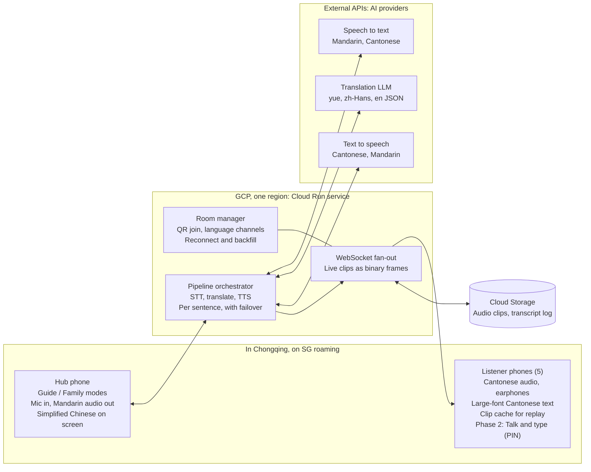
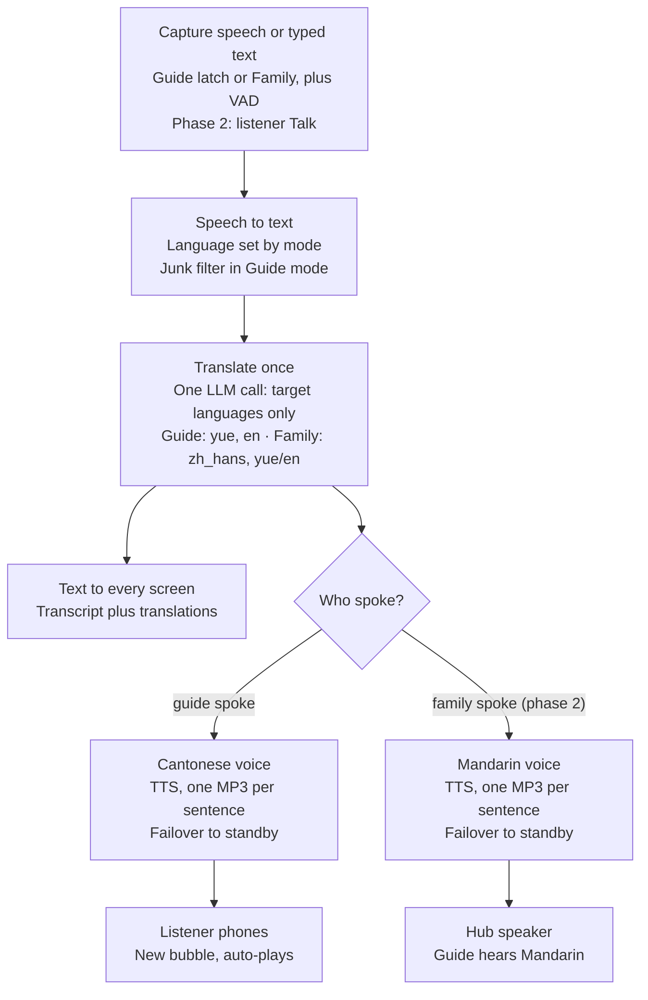
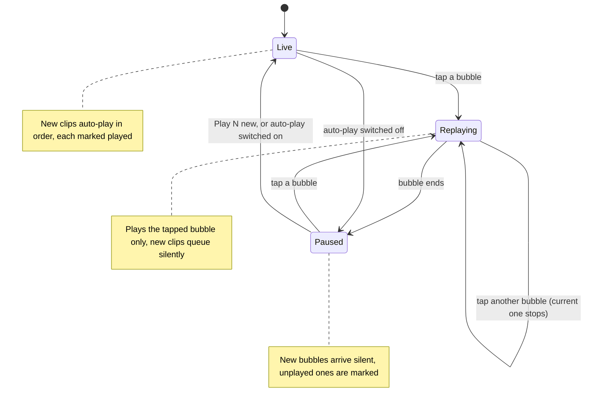
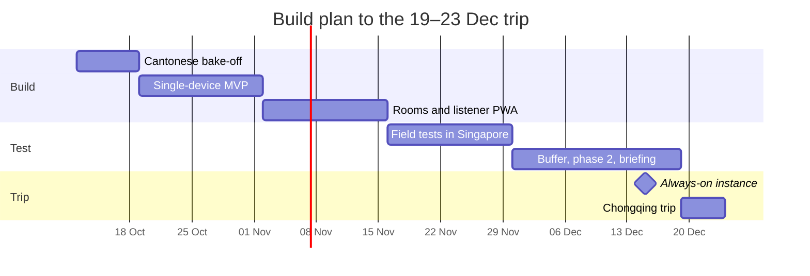

# Chongqing Family Translator — Technical Architecture & Design

Oct 7, 2026 · @Khoon Seng

## Overview

A voice-first web app turns a Mandarin-speaking tour guide into live Cantonese audio for five family members, and their replies into Mandarin for the guide, over Singapore roaming data in Chongqing.

Only two of the seven adults speak Mandarin. The app removes the need for them to interpret every conversation by hand.

**Goals**

- Speech is the main input; typing is available as a fallback.
- Every family listener hears Cantonese audio; the guide hears Mandarin audio.
- Large-font text sits beside the audio as a check on meaning.
- Works anywhere in Chongqing on SG roaming or a non-local-breakout eSIM.
- Field-tested and ready in about two months.

**Non-goals**

- Offline translation, or working on domestic Chinese networks and hotel Wi-Fi.
- Native iOS or Android apps; this is a mobile web app (PWA).
- Simultaneous interpretation. Consecutive interpretation, a few seconds behind the speaker, is the target.

**Build order**

- **Phase 1 (trip-critical): guide → family.** Mandarin speech, or Mandarin typed on the hub, becomes Cantonese audio and large-font Cantonese text on every listener phone. English text follows if time permits.
- **Phase 2: family → guide.** Family members talk (push-to-talk, Cantonese or English) or type on their own phones, if those phones have the hub PIN, and the hub plays the Mandarin once the guide is quiet. The guide always has priority (see "Family replies"). It starts only after phase 1 passes its field test. If it slips past the trip, Khoon Seng and his wife interpret replies, as they would anyway.

**Success criteria**

- Translated audio starts within roughly 2–4 seconds of the speaker finishing a sentence.
- The in-laws pick the Cantonese voice and translations in a blind test.
- No bubble is lost after a dead zone or reconnect.
- Daily running cost stays in single-digit US dollars.

## Users, languages and channels

The app needs only two audio channels, Cantonese and Mandarin, plus text in three languages.

| Person | Speaks | Hears (audio) | Reads (text) | Device |
| --- | --- | --- | --- | --- |
| Guide | Mandarin | Mandarin, from the hub speaker | Simplified Chinese on the hub | Shared hub phone |
| In-laws | Cantonese | Cantonese (must-have, audio first) | Colloquial Cantonese, Traditional characters, large font | Own phone + earphones |
| Wife's siblings | Cantonese, English | Cantonese (must-have) | Cantonese or English | Own phone + earphones |
| Khoon Seng and wife | Mandarin, English, Cantonese | None needed | Optional | Operate the hub; human fallback |

Input language is chosen explicitly, because auto-detecting Mandarin versus Cantonese on short clips is unreliable: on the hub with **Guide** and **Family** talk buttons, and in phase 2 by the **Talk** button on listener phones, which is always family speech. Family input can be Cantonese or English in a single Family mode: speech-to-text receives both `yue-Hant-HK` and `en-US`, and both go through the same pipeline. Typed text may be language-detected; the explicit-mode rule covers speech only.

All family phones are iPhones (iPhone 14 Pro or later, iOS 26.6.2 or later), so every phone-side decision is made for iOS Safari first.

The Cantonese text is written as colloquial spoken Cantonese (粵語口語, e.g. 佢哋喺度等緊我哋), not formal written Chinese, so the same string reads naturally on screen and sounds natural when spoken.

## Hub phone and audio capture

The hub is a spare phone the guide carries on a lanyard, with its own eSIM or physical SIM. Khoon Seng's own phone is the fallback hub. A clip-on mic is deferred until field tests show it is needed.

Why not Khoon Seng's phone: on iOS, Safari stops the mic as soon as he switches to the camera, WeChat or maps, and he needs those apps during the tour. Sharing his Personal Hotspot with the spare phone was rejected because it drains his battery and heats the phone; the spare phone gets its own data line.

**Modes**

- **Guide** is a latch: one tap starts continuous listening, and voice-activity detection (Silero VAD) splits the guide's speech at short pauses (about 0.6–0.8 s), with each chunk capped at 15 seconds. A pause ends a chunk, never the listening session.
- Family replies come mainly from the family's own phones (phase 2, see "Family replies"). **Family** on the hub stays as an option for when Khoon Seng or his wife speak next to the guide; tap **Guide** again to return. The whole screen is tinted a different colour per mode so the current one is unmistakable.
- The hub also takes typed Mandarin, which skips speech-to-text.

**Junk filter (Guide mode)**

With the mic open all day, the hub also hears family chatter, other guides, vendors and the car radio. Speech-to-text, told to expect Mandarin, would turn all of it into garbled transcripts that play as nonsense Cantonese. The filter drops such speech before translation. It never chooses the pipeline; Guide mode stays Guide mode.

1. **Mic close to the guide.** The spare phone on the guide's lanyard (or a clip-on) makes the guide far louder than anyone else. This is the main defence and the only one that helps against other Mandarin speakers nearby.
2. **Drop sentences written in Cantonese** (decided 23 Oct). Speech-to-text receives both `cmn-Hans-CN` and `yue-Hant-HK`. With Mandarin alone, Chirp 3 rewrote Cantonese speech as fluent Mandarin, so chatter would pass as guide speech. With both, Cantonese words survive in the text (我哋, 唔, 喺). The transcript is split into sentences, and a sentence is dropped when Cantonese-only characters (哋, 唔, 喺, 嘅, 咗, 冇, 佢, 嚟, 啲, 嘢, 嗰, 乜, 囉, 喎, 咩, 咁) make up more than a set share of it. The share is **15%, provisionally** (decided 25 Oct): in the bake-off it dropped 0 of 17 real guide sentences at every threshold from 10% to 30%, but no family chatter was recorded in week 1. It is checked against real Cantonese chatter as soon as some is available (forwarded family voice messages, or at the latest the weeks 6–7 field tests). That check also confirms the filter's premise, that Chirp 3 in Guide mode keeps chatter recognisably Cantonese; if it doesn't, the mic's closeness to the guide (layer 1) is the only defence. A Cantonese remark in a pause becomes its own sentence and is dropped, while a guide sentence with one stray 唔 survives. Chirp 3's language labels can't be used: in the smoke test it labelled Cantonese speech as Mandarin in every language order.
3. **Drop fragments.** Very short transcripts and filler (嗯, 啊, 對) are discarded.
4. **Drop our own Cantonese overheard** (echo detection, decided 25 Oct). If a listener phone plays on its speaker near the hub, the hub hears our own translation and would translate it again, in a loop. A test with Despina speaking 31 of our translations into the hub's speech-to-text showed layer 2 can't stop this: Chirp 3 writes the Cantonese with Mandarin characters (係 → 系, 嘅 → 慨, 佢 → 渠), so only 1–3 of 31 were dropped, and adding those characters still caught at most 7. Instead, each guide sentence is compared with the translations sent in the last 60 s, after converting both to Simplified; a mismatch below 0.6 marks an echo. That caught 29 of 31, with no false alarm in 930 comparisons of real guide sentences against other translations (the closest scored 0.67). The two it missed were heard so badly that their translations would differ again, so no loop can form. Side effect: if the guide repeats a sentence word for word within a minute, the repeat is skipped. The same finding means layer 2 may be weaker on real family chatter than assumed; the chatter check settles it.

Chirp 3 returns no usable confidence score, so confidence is not part of the filter.

**Placement**

- Spare hub phone: on a lanyard at the guide's chest, bottom edge (main mic) up.
- Fallback, Khoon Seng's phone: in the car, in a dashboard or vent mount with the bottom edge toward the guide and the radio off; on foot, held at chest height within about 1 m of the guide. Switching to another app stops capture; on return the hub shows a large "Tap to resume listening" banner, and speech in between is lost.

**Hub phone rules**

- **Half-duplex:** the hub pauses mic capture while it plays any audio and resumes when playback ends, so it never hears its own Mandarin output as the guide speaking. Browser echo cancellation (`echoCancellation: true`) stays on as a second layer, not as the main defence. Because the mic is muted while a reply plays, replies wait until the guide is quiet, and the guide can tap the screen to stop one (see "Family replies"). In weeks 2–3 the single-device MVP played the Cantonese on the hub itself, with an "Earphones in" switch to keep capture on; from weeks 4–5 the hub never plays Cantonese, so in phase 1 it never pauses capture.
- No Bluetooth earbuds connected to the hub phone; the phone may silently switch to their mic.
- Bring a car charger and power bank: continuous mic, screen wake lock and roaming data drain the battery fast.

**Clip-on mic (deferred)**

Decided at the weeks 6–7 field test by comparing transcripts: the spare hub phone on the lanyard versus a clip-on worn by the person playing the guide. A clip-on matters most if there is no spare phone and the hub stays about 1 m away. If bought, it is a wireless kit whose receiver plugs into USB-C or Lightning, never Bluetooth, and the app simply uses the phone's default audio input.

**The spare hub phone (decided 13 Oct, subject to getting one)**

- **Benefit:** the mic sits at the guide's mouth rather than about 1 m away, which should improve STT in noisy places, strengthens the junk filter and may remove the need for a clip-on mic.
- **Hub behaviour:** stays latched in Guide mode; the guide never switches modes. In phase 2, Mandarin replies play from its speaker, since the guide wears no earphones.
- **Family replies move to their own phones (phase 2):** phones with the hub PIN gain a hold-to-talk button (Cantonese or English) and a text box; the hub's Family button stays as an option (see "Family replies").
- **The phone:** any spare iPhone or Android phone with its own eSIM or physical SIM routed through SG roaming (not Khoon Seng's hotspot). It is locked to the app with Guided Access (iOS) or App Pinning (Android), carries no personal accounts, and comes with a lanyard and a power bank.

## Family replies (phase 2, decided 24 Oct)

Family members reply from their own phones, by talking or typing; the hub on the guide's lanyard plays the Mandarin. The guide always has priority: a family member can never cut off or block the guide's speech.

**Who can reply**

- Only phones that have entered the hub PIN show the **Talk** button and the text box, since both trigger paid provider calls (hard rule 1). Phones without the PIN listen only.
- In the private vehicle that is likely about 3 phones, so entering the PIN once at the start of the trip is a small cost. The phone remembers it, also after the app is closed.
- If Khoon Seng has a spare phone of his own, he is simply one of the listeners.

**Talking: push-to-talk, after the guide pauses**

- **Push-to-talk:** hold **Talk** while speaking, Cantonese or English (speech-to-text receives `yue-Hant-HK` and `en-US`). It is never an open mic, so family chatter never reaches the guide and no junk filter is needed on listener phones. A recording is capped at about 30 s.
- **The Talk button decides the language:** speech from it always takes the family → guide pipeline, so no language is guessed (hard rule 8).
- **Guide priority:**
  - The hub tells the server when the guide is speaking, from its own voice-activity detection.
  - While the guide speaks, listener phones show "Guide is speaking…" and Talk won't start.
  - Talk becomes available after the guide has been quiet for **2 s**, the same pause that starts a new bubble, so nobody grabs the short gap between two of the guide's sentences.
  - Once a family member has started, they can finish even if the guide starts again: the guide is captured by the hub, so nothing of his is lost.
  - If the guide narrates without pausing, Talk keeps waiting and typing is the way in.
- **Half-duplex on the listener phone:** while Talk records, the phone pauses its own playback (and any locked-screen keep-alive) and resumes afterwards (hard rule 13).

**Typing**

- Typing works at any time, whether or not the guide is talking.
- Typed and spoken replies and the guide's sentences appear on every screen in order of arrival, each as its own bubble.

**Mandarin replies on the hub**

- The Simplified Chinese text appears on the hub at once.
- The audio is queued and plays only after the guide has been quiet for 2 s, because the hub's mic is muted while it plays (hard rule 13). Replies play in order of arrival.
- The guide can tap the hub screen to stop a reply; the mic reopens at once.

**To test when phase 2 starts**

- Whether iOS asks for microphone permission again in each session of a Home Screen app.
- Whether opening the mic switches iPhone audio to call routing (quieter, through the earpiece), and whether it switches back afterwards.

## System architecture

A single Cloud Run service sits between one shared hub phone and five listener phones, calling external STT, translation and TTS APIs on their behalf.

&#91;embedded content: system architecture · hub, Cloud Run, providers, listeners\]

The hub sends speech in and plays Mandarin out; the orchestrator runs each sentence through the providers, stores the clip in Cloud Storage and pushes it to listeners over WebSockets.

Mermaid version, for the Markdown copy in the repo:

## Translation pipeline

Every sentence runs through one cascade: speech to text, a single translation call, then text-to-speech only for the listeners who need audio.

&#91;embedded content: translation pipeline · per sentence\]

Guide speech becomes Cantonese audio for the listeners; family speech (phase 2) becomes Mandarin audio from the hub speaker. Every screen gets text: the transcript in the source language plus the translated languages.

Mermaid version, for the Markdown copy in the repo:

A single cascade replaces a hybrid of OpenAI's realtime translator plus a Cantonese cascade. One pipeline keeps the Cantonese and Mandarin channels in step and leaves one integration to maintain.

## Model and provider choices

Google Cloud is the primary provider for every stage, each stage has a fallback from another provider, and the week-1 bake-off judged by the in-laws confirms or overturns each choice.

| Stage | Primary | Fallback | Notes |
| --- | --- | --- | --- |
| STT, Mandarin, Cantonese and English | Google Speech-to-Text V2, `chirp_3` model, **streaming** (decided 24 Oct): cmn-Hans-CN (GA), yue-Hant-HK (Preview), en-US. Runs only in the `us` and `eu` multi-regions. The glossary is also passed as phrase biasing | OpenAI `gpt-transcribe` (US$0.0045/min) on the saved audio segments: the **safety net** for gaps Chirp 3 leaves, and the **fallback** when the stream fails | On 16 real guide clips, `gpt-transcribe` scored 12.7% error and Chirp 3 streaming 13.4% (excluding one clip it cut short); `gpt-4o-transcribe` scored 32.3% and is not used. The family recordings will check that `gpt-transcribe` doesn't return Mandarin-style text for Cantonese speech. Chirp 3 costs US$0.016/min after 60 free minutes a month, so the trip's ~900 minutes cost about US$13 or come out of Google's free-trial credit |
| Translation | Gemini 3.6 Flash on **Vertex AI**, the bake-off winner (decided 24 Oct; primary regardless of Google's abuse-monitoring answer) | Groq `qwen/qwen3.8-27b` (Preview; `openai/gpt-oss-120b` if it is withdrawn), then Google Cloud Translation v3 as the last resort | In-laws' blind test: Gemini best for 7 of 10 sentences, Qwen 2, gpt-oss 1, Cloud Translation 0 |
| TTS, Cantonese and Mandarin | Google Chirp 3 HD, Cantonese voice **`yue-HK-Chirp3-HD-Despina`** (decided 24 Oct), one non-streaming request per sentence returning MP3 | Older Google voice `yue-HK-Standard-A` | In-laws' blind test: Despina 2 votes, Standard-A 2, Zephyr 1, Iapetus 0. MP3 because it plays on every iPhone; Ogg Opus support in iOS Safari is unconfirmed, and per-sentence clips gain little from streaming |
| Pause detection | Silero VAD in the browser (`@ricky0123/vad-web`) | None | 15-second chunk cap; the server splits long transcripts at punctuation |

**Adapters and credentials.** The translation adapter is a single OpenAI-compatible client, configured per provider with a base URL, model and key, so switching between Gemini and Groq is a config change. STT and TTS adapters are provider-specific. On Cloud Run, Google's speech APIs and Gemini on Vertex AI authenticate with the service account, so they need no API keys; Secret Manager holds only the Groq and OpenAI keys, the hub PIN and the API token; the join link's room token lives in the private bucket, so host phones can renew it. Groq's lineup changes quickly (Qwen3.6-27B was replaced by Qwen3.8-27B within weeks), so model IDs live in config and are re-checked before the trip.

**Translation call design.** One LLM call per sentence returns the target languages as JSON, never the source language: guide speech returns `yue` (and `en` once English is added), and family speech in phase 2 returns `zh_hans` plus whichever of `yue` or `en` wasn't spoken. The transcript itself is the source-language text, so the model can't reword what was said, and fewer output tokens means less waiting. The field TTS needs comes first and is streamed, so TTS can start as soon as it closes. The prompt carries a glossary of Chongqing place and dish names (解放碑, 洪崖洞, 磁器口, 毛血旺) and only the last 2–3 utterances as context.

**Prompt rules proven in the bake-off (runs 4–6, 24 Oct, `bakeoff/prompts/guide_to_family.md`):**
- **Speech-recognition input:** the guide's words may contain false starts, repeats and filler. Say what the guide means, cleanly, without changing statements, questions, negations or facts, and never turn an action into its opposite.
- **Cantonese words, same meaning:** 第二天 → 第二日, 每天 → 每日, 明天 → 聽日 (only where the guide said 明天), 您/你们 → 你/你哋, 这样 → 咁樣, 很 → 好; times of day as notes (朝早 for 早上, 夜晚 or 晚黑 for 晚上), each only where the guide said that time.
- **Change only words Cantonese says differently;** words it shares with Mandarin (排隊, 拍照, 坐車) stay as they are.
- **No accidental repeats.**

Two lessons from run 6 (decided 24 Oct). Telling Gemini to "swap Mandarin words for Cantonese ones" made it over-swap: on 洪崖洞晚上七点半以后开灯 it turned 開燈 ("lights on") into 熄燈 ("lights off") in 7 of 16 outputs; with "change only words Cantonese says differently" it did so in 0 of 12. Inviting it to fix "small recognition errors" let it "correct" words that were right (熄燈……唔係，開燈). Mandarin words left in and times the guide never said stayed at 0 of 93 for both Gemini and Qwen.

On 21 real guide sentences, these took Gemini from 12 day-word slips (天) and 3 other Mandarin words to none. A first wording that listed 聽日 and 朝早 as examples made Qwen invent "tomorrow" and "morning" (4 errors); listing them as substitutions fixed it.

**Sampling settings.** Temperature and top-p are set per model in config. They change how the model picks words: low means consistent and literal, high means more varied wording with more risk of errors. **All three models run at temperature 0.2 (decided 23 Oct, from bake-off evidence):**

| Model | Higher setting tested | What went wrong at the higher setting |
| --- | --- | --- |
| Gemini | 1.0, Google's general advice | About 7 errors in 29 outputs, against 1 at 0.2: stray English words (`四十 processing 分鐘`) and wrong words (好多年夜食 for 小食, 爬好多年樓梯) |
| gpt-oss | 1.0 with top-p 1.0, its makers' advice | Repeated `聽住，` 36 times |
| Qwen | 0.7 with top-p 0.8, its makers' advice | Gave 兩點半 for 一點半 |

Gemini at 0.2 was also faster. Google's advice to keep 1.0 is mainly about reasoning tasks, and here reasoning is at its minimum. Cloud Translation, Chirp 3 and the voices have no such settings.

**Reasoning off.** Reasoning ("thinking" before answering) is switched off on the translation model, or set to its lowest level where it can't be switched off (`gpt-oss-120b`: low), through per-provider config. For one sentence with a glossary it rarely improves quality and adds one to several seconds. Speech-to-text and text-to-speech have no reasoning setting and are unaffected. The bake-off runs each model both ways; if "off" loses noticeably in the blind test or the colloquial-marker score, the lowest setting that wins is used.

**Google Cloud Translation (last-resort translation fallback, decided 24 Oct; added as a candidate 14 Oct).** This is Google's translation API, the same family as the Google Translate app, but it takes **text only**. It can replace only the translation step; speech-to-text, pause detection and text-to-speech stay as designed. The app's early cut-off after short pauses comes from the app's own listening logic and doesn't apply to the API.

- **Strengths:**
  - Meets zero data retention by default: text is "held briefly in-memory" and never used for training, so no exception request is needed.
  - Typically answers in a few hundred milliseconds, faster than an LLM.
  - Priced per character with a monthly free allowance (re-check before the bake-off).
  - Authenticates with the service account, so no key is needed.
  - Its failure modes are unrelated to Groq's caps and Vertex AI's 429 errors.
- **Limitations:**
  - Cantonese is supported only by the standard (NMT) model, not by Google's Translation LLM, so the output style can't be steered toward colloquial Cantonese.
  - Each sentence is translated without the previous 2–3 sentences as context.
  - One call per target language.
  - Glossaries must be uploaded from a Cloud Storage bucket, and the docs don't confirm they work with Cantonese.
- **What it would take to adopt:** a provider-specific translation adapter alongside the OpenAI-compatible LLM client, and rewording hard rules 4 and 6, which assume an LLM. Rules change only if it wins a role, and with the owner's approval.
- **Role (decided 24 Oct): last-resort fallback.** It translates a sentence only when both Gemini and Qwen have failed on it. In the bake-off it never added an error and was by far the fastest (0.2 s). But it was the in-laws' least-liked option (best for 0 of 10 sentences), and on real speech it copies the guide's false starts word for word (佢係佢都係有嗰個清), so it is not used otherwise. Hard rules 4 and 6 are worded to allow this.

**Failover.** If a provider errors or is too slow on a sentence, that sentence goes to the next provider at once: Gemini → Qwen on Groq → Cloud Translation. Vertex AI 429s are never retried, since they can last for long stretches. Only if all three fail does the app show the transcript and flag the hub operator to interpret.

**Gemini deadline and junk check (decided 24 Oct).** Two more triggers send a sentence to Qwen:
- **Deadline:** Gemini's `yue` must be complete within about 2.5 s (tuned in testing). In run 6, 24 of 93 Gemini calls took over 4 s, the slowest 14 s, and 11 failed outright (7 refusals, 4 timeouts at 20 s); Qwen's slowest was 0.9 s. Gemini's median was 2.05 s that day, against 1.49 s on 23 Oct.
- **Junk check:** if `yue` contains Latin letters, Qwen's translation is used instead. Gemini occasionally writes a junk word whatever the prompt (多 goods for "lots of people", "processing", "paddingTop"); the original prompt did it too on the day of run 6. The check catches the English ones. Chinese junk such as 好多年夜食 ("lots of New Year's Eve food" for "lots of snacks") gets through; it appeared in 3 of 93 run-6 outputs, all on one drafted sentence, and never on the guides' real sentences.

**Ruled out.** OpenAI GPT-Realtime-Translate (no Cantonese output voice), conversational realtime models (an assistant, not an interpreter), Groq TTS (no Chinese voices, and Groq does not host Qwen3-TTS), the Gemini API free tier in AI Studio (prompts may be used to improve Google's models, so it fails ZDR), Qwen3-TTS on Alibaba Model Studio (ZDR only for enterprise customers, and flagged content can be kept for up to 2 years) and Azure Speech (kept to one cloud provider). OpenAI's API has no free tier, so it serves only as a paid STT fallback. OpenAI `gpt-live-transcribe` (US$0.017/min) streams, but only through the Realtime API, which keeps data for 30 days for abuse monitoring unless OpenAI approves zero data retention. A streaming fallback would also add little: it only covers a Chirp 3 outage, and the file-based fallback answered a 5-second clip in about 1–2 s. It would be reconsidered only as a Chirp 3 replacement, and only if OpenAI confirms zero retention in writing.

**Streaming speech-to-text with a safety net (decided 24 Oct; hard rule 9)**

Non-streaming Chirp 3 took about 3 s to transcribe a 5-second clip, on top of about 0.7 s of pause detection and the upload: too slow for the 2–4 s target. Streaming transcribes while the guide talks. Our design never lost speech at pauses, because Guide mode stays latched; streaming is about speed and whole sentences.

- **Hub:** sends speech audio over its WebSocket while Guide is latched. The browser VAD still holds back long silences, which saves money because Chirp 3 bills per second of audio. Its pauses also cut the saved audio into segments for the fallback.
- **Server: one Chirp 3 stream per hub segment** (decided 25 Oct). A stream opens when the hub's VAD starts a segment and closes when the segment ends, which makes Chirp 3 return the segment's final transcript at once instead of waiting for its own pause detection. Google's limits still apply within a segment: each message carries at most 25 KB, and audio must arrive at real-time pace; segments are capped at 15 s, far below the 5-minute stream limit. Chirp 3's final transcripts are split into sentences at punctuation, filtered (junk filter) and translated one by one; a later segment's sentences wait for the earlier segment's, so the order never changes.
- **Why not one long-lived stream** (the 24 Oct design): in the weeks 2–3 tests, a stream kept open across several segments lost a whole 13.8 s segment of real guide speech (7-0010) in 3 of 3 runs, reproduced directly against Chirp 3 without the app; with a stream per segment it came through in full, with final transcripts 0.5–1.6 s after the speech ended instead of about 1.8 s. The safety net is still needed: the clip Chirp 3 cut short in week 1 (6-0008) is still cut short per segment.
- **Safety net:** when a segment ends, the server checks that Chirp 3's final transcripts reach to within 1 s of its end. If they don't, only the uncovered audio goes to `gpt-transcribe` (starting 0.2 s early so no word is clipped), which answered a whole segment in about 1 s in the bake-off. Built 25 Oct: on 6-0008, where Chirp 3 stops at "…一边", `gpt-transcribe` supplied the last 5.7 s in 1.7 s, and the sentence reached the hub 4.6 s after the speech ended. A transcript that just repeats `gpt-transcribe`'s glossary prompt (a known habit on silence) is discarded.
- **Fallback:** if the stream fails, the whole segment goes to `gpt-transcribe`. Each segment opens a fresh stream, so the fallback lasts only as long as Chirp 3 keeps failing.
- **Half-sentence hold** (decided 25 Oct): a sentence ends at punctuation, not at a pause. When a segment's last words have no sentence-ending punctuation, they are held; if the guide carries on within 1.5 s, the next segment's words are joined to them and the whole sentence is translated once; otherwise they go on as they are. In testing, Chirp 3 left 4 of 6 mid-sentence cut-offs unpunctuated ("…然后", "…他是"), and both live tests came back as one sentence each. Complete sentences are never delayed; the other 2 cut-offs, which Chirp 3 ended with a full stop, still go out as halves.
- **Why streaming stays the main path** although `gpt-transcribe` was as fast on short clips: with long non-stop narration, non-streaming STT has to wait for a pause or the 15 s cap before it can start, while streaming delivers each sentence about a second after it ends. Chirp 3 also runs on Google's free credits.
- **First synthetic test (23 Oct, laptop in Singapore):** each sentence's final transcript arrived 0.8–1.0 s after its audio, about 1.7–2.0 s after the speaker stopped, because Chirp 3 first waits for a short silence. "Standard" endpointing kept sentences whole; "short" split mid-word ("排队可能要40分" / "钟左右"), so standard is the default.
- **Real recordings (23 Oct, 16 chunks from 10 WeChat voice messages by local guides, 2 min):**

  | Run | Median delay | p90 delay | Speech dropped |
  | --- | --- | --- | --- |
  | Chirp 3 streaming, standard | 2.0 s after the speaker stopped | 2.3 s | 1 of 16 chunks (4.6 s lost, in all 8 repeat runs) |
  | Chirp 3 streaming, short | 1.8 s | 2.4 s | 2 of 16 chunks |
  | Chirp 3 non-streaming | 3.2–3.4 s, plus ~0.7 s of pause detection | 5.3–5.7 s | none |
  | OpenAI `gpt-transcribe`, non-streaming | 1.0 s, plus ~0.7 s of pause detection | 1.2 s | none |
  | OpenAI `gpt-4o-transcribe`, non-streaming | 1.3 s, plus ~0.7 s of pause detection | 1.9 s | skipped parts of 2 chunks |

  In the dropped chunk, Chirp 3 sent a final transcript mid-sentence at 8.6 s and never transcribed the remaining 4.6 s, even with extra trailing silence. Levelling the volume didn't stop it and made transcripts worse.
  - **Accuracy** against the owner's corrected transcripts (numbers written as digits or words count as equal):

    | Run | Error rate |
    | --- | --- |
    | `gpt-transcribe` | 12.7% |
    | Chirp 3, non-streaming, glossary | 12.7% |
    | Chirp 3 streaming | 18.4%, or 13.4% without the clip it cut short |
    | Chirp 3, non-streaming, Mandarin + Cantonese | 15.6% |
    | `gpt-4o-transcribe` | 32.3% |

  - **Junk filter:** dropped 0 of 17 real guide sentences at every threshold tested.
- **Still to test:**
  - how Chirp 3 splits long, continuous narration (`02b_stt_streaming.py --continuous` on longer recordings);
  - whether the junk filter catches real family chatter (a 1–2 minute recording).

## Data retention (ZDR) and the primary translation model

Every provider in the stack must keep zero data from the family's conversations, with two accepted Google exceptions (decided 24 Oct): the app sticks with Google whatever Google answers. The two requests to Google are now optional.

| Provider | ZDR status | Action needed |
| --- | --- | --- |
| Google Speech-to-Text (sync) | Met by default: audio processed in memory, nothing stored | Never opt into data logging; never use the async (batch) endpoint |
| OpenAI transcription (STT fallback) | Met by default: no training, no abuse-monitoring or application-state retention on this endpoint | None |
| Gemini on Vertex AI | Accepted exception: Google may keep prompts and replies for abuse monitoring unless it grants an exception | Disable in-memory caching on the project; requesting the exception is optional |
| Groq | Self-serve | Switch on Zero Data Retention in Data Controls |
| Google Text-to-Speech | Accepted exception: Google's standard terms, without written confirmation of no retention (it receives only the Cantonese translation) | None; asking Google is optional |

**Our own app: logs follow ZDR, storage is a deliberate exception**

- Cloud Run logs hold request IDs, timings and errors only, never transcripts, translations or audio.
- Cloud Storage keeps clips and transcripts for **30 days** (decided 13 Oct), so Khoon Seng has time to download anything the family wants to keep. This is our own storage, not a provider's, and the exception was approved explicitly.
  - A lifecycle rule deletes objects after 30 days. Lifecycle deletion runs on a schedule, so an object can outlive its age by up to about a day.
  - Soft delete is set to 0 on the bucket. Otherwise Cloud Storage keeps deleted objects for another 7 days by default, including lifecycle deletions.
  - The bucket is private. Clips reach phones only through the app, checked against the room token, never as public links.
- Listener phones keep their IndexedDB cache; there is no end-of-day clear. Saving or exporting a bubble and browsing previous days come after the trip; until then, downloads are done manually from the bucket.

**The translation order (decided 24 Oct)**

Gemini on Vertex AI is primary, Qwen on Groq the fallback and Cloud Translation the last resort. Gemini and Groq fail in unrelated ways: Groq by hitting fixed caps, Vertex AI by a busy shared pool returning 429 errors.

This is real, not theoretical. In translation bench run 2 (23 Oct), Vertex AI refused **38 of 100 Gemini requests with 429** and timed out on 4 more, while the morning's run 1 had none. Groq refused 1 of 61 requests, on its Free plan, and Cloud Translation none. So a 429 must fail over to Groq on the same sentence at once, with no waiting or retrying.

**First translation findings (bench runs 1–2, 10 drafted sentences, AI-read; the in-laws' blind test decides):**

| Option | Strength | Weakness | Median time |
| --- | --- | --- | --- |
| Gemini 0.2 | Most natural Cantonese | Hardest to reach (429s) | 1.4 s |
| Qwen 0.2 | Fast and colloquial | Occasionally awkward or wrong phrasing | 0.5 s |
| gpt-oss 0.2 | Steady | Repeated grammar slip (人好多人) | 1.0 s |
| Cloud Translation | No errors and identical every time | Stiff, Mandarin-style wording | 0.2 s |

- **Gemini won the bake-off (24 Oct)** and is the primary translator, whether or not Google grants the abuse-monitoring exception (accepted exception, hard rule 14).
- **Groq's model is Qwen3.8-27B,** which clearly beat gpt-oss-120b (in-laws: 2 picks to 1, naturalness 2.0 to 1.7; on real speech gpt-oss once reversed a negation). Because Qwen is a Groq Preview model, `openai/gpt-oss-120b` stays configured to take its place if Groq withdraws it.

**Text-to-Speech:** no ZDR-verified Cantonese voice exists among the providers considered, so Google's standard terms are accepted (decided 24 Oct).

## Listener experience and playback rules

The listener screen works like a WhatsApp voice-note thread: audio first, large-font Cantonese text under every bubble, and any bubble replayable on its own.

**Chunks, sentences and bubbles**

Three units work at different levels, so the 2-second bubble rule never delays translation.

| Unit | Ends when | Who sees it |
| --- | --- | --- |
| Chunk (sent by the hub) | A short pause (about 0.6–0.8 s, tuned in testing) or the 15 s cap | Nobody; it exists for speed |
| Sentence (one audio clip) | The server splits the transcript at punctuation | Tap a sentence to replay it |
| Bubble (one voice note) | A pause longer than 2 s, a mode switch, or the bubble reaching 45 s of audio or 6 sentences | Tap a bubble to replay it |

The hub sends the pause length before each chunk, and the server decides where bubbles break.

**Keeping up with fast speech**

Clips play at **normal speed (1.0×)** by default (decided 24 Oct). On the 21 real guide sentences, Despina's Cantonese took **90%** as long as the guides' own Mandarin: 106 s against 119 s. Gemini drops the false starts and filler, so listeners don't fall behind on average. Single sentences ran up to 1.6× longer.

The only risk is a fast guide talking for minutes without pausing, where clips could queue up. For that case there is a **"Jump to latest" button** (decided 24 Oct), chosen over an automatic 1.1× because it is simpler and the voice never changes speed:
- When 3 or more clips are waiting in Live, a large **跳到最新 / Jump to latest** button appears.
- Tapping it stops the current clip and plays the newest one.
- The skipped clips stay unplayed and marked, like unheard voice notes, so they can be replayed.
- The threshold of 3 is tuned in the field tests.

**Bubbles**

- Each bubble groups up to 6 sentences; each sentence inside it is its own audio clip.
- Phones with the hub PIN can talk or type replies (phase 2, see "Family replies").
- Tap a bubble to replay the whole turn; tap a sentence to replay just that sentence.
- The guide's original Mandarin shows in small text under each bubble, so Khoon Seng or his wife can check a confusing translation on the spot.
- Unplayed bubbles carry a visible marker, like unheard voice notes.

**Player states**

&#91;embedded content: listener player states, Live, Replaying, Paused\]

A replay plays only the tapped bubble and then stops in Paused; it never runs on into later bubbles. In Paused, new clips arrive silently so the listener can read instead of listen, until they tap **Play N new** or switch auto-play back on.

Mermaid version, for the Markdown copy in the repo:

- Tapping another bubble mid-replay stops the current one at once; two clips never overlap.
- In Live, when 3 or more clips are waiting, **跳到最新 / Jump to latest** skips to the newest clip; skipped clips stay unplayed (see "Keeping up with fast speech").
- Replays never re-call TTS: clips are cached on the phone (IndexedDB) and backed by Cloud Storage, so a replay works even in a tunnel.
- Each phone shows a tap-to-start screen on joining, which unlocks audio on iOS, and holds a screen Wake Lock while in a room.
- **Sound off (text only)** (decided 26 Oct): a per-device switch for anyone who only wants to read, mainly a tablet in the car, so its speaker never feeds the hub's mic (echo detection is the backstop).
- **Tablets (iPad)** use the same link and app, with larger text on the bigger screen. A Wi-Fi-only iPad has no SG roaming and hotel or local Wi-Fi blocks Google, so it must join a family phone's Personal Hotspot; an iPad with its own roaming eSIM works like a phone. Keeping the screen on needs iPadOS 16.4 or later.

**Locked screen: silent keep-alive (decided 24 Oct)**

Listeners can lock the phone or put it in a pocket and still hear every clip.

- **The problem** (week-1 test on an iPhone, in a Safari tab and as a Home Screen app alike): iOS freezes a locked page about 10 s after its audio stops, and its WebSocket dies with it, so the next clip never arrives. Clips 7 s apart survived; clips 50 s apart did not. Web Audio failed at once.
- **The fix:** while in a room, a second audio element loops one second of digital silence that the phone makes itself: every sample is zero, so there is nothing to hear and no network traffic. iOS counts it as playing audio and keeps the page running. Clips play on the main player as before, so the player states and rules are unchanged. In the test, clips arrived and played on schedule after about 50 s of silence, with no added delay, in a Safari tab and from the Home Screen.
- **Rejected: "radio mode"**, one continuous MP3 stream per listener. It also kept playing when locked, but Safari's buffering added about 6 s of delay, and the server couldn't tell when a phone had stopped listening (streams ran on for 30 minutes after Stop).
- **If iOS pauses the keep-alive** (seen once, from the lock-screen controls or as the phone woke), the app restarts it; if that fails, it shows "Tap to resume audio".
- **Never on the hub,** whose screen stays on and whose mic must not be muted by endless playback (hard rule 13). On a family phone it pauses while Talk records (phase 2).
- **To check in the weeks 6–7 field tests:** battery drain over a full day, and locks of an hour or more.

## Hosting, networking and China access

The roaming SIM, not the cloud region, is what keeps the app reachable in Chongqing; everything runs in `us-central1`.

**Connectivity**

- Every phone uses SG roaming or an eSIM confirmed to route outside China (no local breakout). Traffic exits in Singapore, so Google, OpenAI and Groq behave as they do at home.
- Wi-Fi stays off while the app is in use. Hotel and café Wi-Fi is on the domestic network, where Google domains are blocked whatever the region.
- Nothing is hosted in mainland China, which would need an ICP filing.

**Compute: Cloud Run**

- One service holds the Vue PWA, the FastAPI WebSocket endpoint and the pipeline, built as one container.
- Code stack (libraries confirmed 25 Oct): Python 3.12 with FastAPI, managed with `uv` and tested with `pytest` and `pytest-asyncio`; Vue 3 + Vite in plain JavaScript (no TypeScript), with Pinia, `vite-plugin-pwa`, Silero VAD (`@ricky0123/vad-web`), Tailwind CSS and Vitest.
- `max-instances=1`, because room state lives in memory and a second instance would split the room.
- WebSocket connections are cut at the request timeout (60 minutes maximum); the client's reconnect-and-backfill logic handles it.
- Run at 1 vCPU. Below 1 vCPU, Cloud Run forces maximum concurrency to 1, which would allow only one WebSocket connection.
- Provider API keys live server-side in Secret Manager; phones never call providers directly.
- Only a phone that has entered the hub PIN can send audio or text, so a leaked link or photographed QR code can't run up provider costs or post into the room.
- **API token (decided 25 Oct):** the hub also sends an API token, and the token guards the API description (`/openapi.json`) and every API endpoint, so the interactive API list at `/docs` can stay on in the real app. The PIN and the token are both 8 digits and entered once per hub phone. The `/docs` page itself is an empty shell that asks for the token and sends it as a header, never in a URL, so it stays out of request logs. Only `/health` and the page's own files are open. Listener phones still join with the QR room token alone.
- `min-instances=1` from 15 Dec to 23 Dec 2026, so the first sentence of the day never waits for a cold start; set back to 0 on 24 Dec. At all other times the service scales to zero.

**Region: `us-central1` (decided 13 Oct)**

- Chirp 3 speech-to-text runs only in the `us` and `eu` multi-regions. Hosting in Singapore (`asia-southeast1`) would still cross the Pacific for speech-to-text and, for Groq, translation, so latency would be roughly a tie.
- `us-central1` keeps Cloud Run, Cloud Storage, Vertex AI and text-to-speech in one place, inside the Cloud Storage free allowance, and new Google models usually arrive there first.
- Phones still connect through Google's edge in Singapore; the crossing to Iowa runs on Google's own network.
- No two-region test. Week 1 measures time-to-first-audio in `us-central1` only; moving region later is a redeploy.

**Storage: Cloud Storage**

- Each sentence's audio is saved as an MP3 clip, plus a transcript log per room. Everything is kept 30 days (see "Data retention").
- Live clips travel inline over the WebSocket as binary frames to every phone at once (fan-out), each phone with its own send queue so a phone on weak signal never delays the others.
- Each sentence is stored as two objects, its MP3 and a small JSON record, because Cloud Storage objects can't be appended to. On a restart (scale to zero, a new revision) the server reloads the day's records, so bubbles and numbering carry on.
- **Replay comes from the phone; catch-up comes from the server** (decided 26 Oct). Every clip is saved on the phone (IndexedDB) as it arrives, so replays are instant and work in a tunnel. After a reconnect, a late join or a cleared cache, the phone says which sentence it has last, and the server sends what it missed, from memory or the bucket, over the same WebSocket, so no new web address is needed and listeners never need the API token.
- A full trip is a few hundred MB, inside the 5 GB free allowance in US regions and pennies elsewhere.

**Hub upload.** The hub sends raw 16 kHz PCM, about 350 MB a day for 3 hours of speech, which avoids an audio-encoder dependency. Data is not a constraint on Khoon Seng's phone (Singtel GOMO includes 60 GB of roaming data a month); the spare hub phone's eSIM or SIM needs about 2 GB for the 5-day trip.

**One fixed room, one active hub**

- There is a single fixed room for the whole trip (decided 26 Oct). Its bubbles start fresh each trip-local morning (Asia/Shanghai) and sentence numbers restart, while earlier days stay in the bucket for download. A separate room per day was considered and rejected: the in-laws would need a new link every morning, and a phone left on yesterday's link would hear nothing.
- **Listeners join with a link** (decided 26 Oct): `…/join#<room token>`, shared in the family WhatsApp group. They tap it once in Safari, tap Start, and the phone remembers it. The token follows a `#`, which the phone never sends anywhere: it stays out of Cloud Run's request logs and out of WhatsApp's link-preview fetch, and the page removes it from the address bar. Tapping it works exactly like an ordinary link. A Safari tab is the recommended way in: a Home Screen icon keeps separate storage on iOS and may open without the token. There is no QR code for now; one can be added if the field tests show a need.
- **Why a token in the link rather than an open address or a typed passcode:** an open address is no easier for the in-laws (they tap a link either way) but would let anyone who found it read and hear the narration, later the family's replies, and 30 days of replays. A typed passcode is the slowest and most error-prone for elderly users. Listeners can never trigger paid calls either way. If the link leaks, a host phone makes a new one: the old link stops working at once and phones still on it are disconnected. The token lives in the private bucket (`settings/`, outside the 30-day rule), not in Secret Manager, so it can be renewed from the app.
- **Host controls** (decided 26 Oct): Khoon Seng's and his wife's phones sign in through a separate host link (`/host`) with the hub PIN and API token. Only they see the day's spend, **Pause / Resume Guide**, **Become hub** and the join link (**Share link**, **Make a new link**), each risky action behind an "Are you sure?". A host phone needs no join link. The family's join link offers no host sign-in, and the server refuses host actions from any phone that didn't sign in as host.
- **Remote pause** (decided 26 Oct): a host phone can pause and resume the hub's Guide listening, for example when the family chats in the car while the guide is quiet. The hub's screen shows that it was paused from another phone.
- Exactly one phone is the active hub at a time; two hubs would capture the guide twice and duplicate bubbles.
- **Hub PIN:** a short code entered once on any phone allowed to act as hub or, in phase 2, to talk or type replies; the phone remembers it. Phones that only listen never need it.
- **Changing the hub:** if the hub's battery dies or it drops off, either a host phone taps **Become hub**, or any phone opens the hub page, enters the PIN and token and taps Start. Either way the server moves the hub role to that phone, and bubble history and numbering carry on unbroken, because the pipeline belongs to the room, not to the hub's connection. The old hub is told "Another phone is now the hub" and stops listening; it offers "Listen on this phone" and "Make this phone the hub again". Become hub simply opens the hub page on the host phone and starts it. Only a deliberate Start or Become hub takes over: a hub that reconnects by itself (say the spare phone comes back from a dead zone after someone took over) never takes the role back, and shows "Another phone is now the hub" instead (decided 26 Oct). The hub plays no audio from weeks 4–5 on: listener phones play the Cantonese.
- **Hub offline:** if the hub is unreachable for more than about 20 seconds, listener phones show a "Hub offline" banner so someone knows to take over.

## Latency, rate limits and cost

The target is about 2–4 seconds from end of sentence to translated audio, at a few US dollars a day; tokens never pile up because every call is stateless.

**Measured in week 1, and accepted (decided 24 Oct).** A test service in `us-central1`, with an iPhone on Singapore mobile data, measured about **4.2 s** median from the end of speech to Cantonese audio (3.8–6.5 s over 10 runs): Chirp 3's final transcript 1.8 s, Gemini 1.0 s, text-to-speech 0.9 s, MP3 download 0.4 s. This is slightly over the target and accepted as it stands. The ~2.5 s Gemini deadline (see "Failover") keeps a slow Vertex day from stretching it much further. It is measured again in the weeks 6–7 field tests with the family, on the real app; speed-ups are considered only if it feels too slow there.

**Latency budget (estimated before week 1)**

| Step | Expected time |
| --- | --- |
| VAD waits for the pause that ends a chunk (non-streaming only) | 0.6–0.8 s |
| STT, Chirp 3 streaming: end of speech to final transcript (16 real clips, 23 Oct) | ~2.0 s (p90 2.3 s) |
| STT, safety net only: `gpt-transcribe` on the uncovered audio | ~1.0 s |
| Translation LLM, first sentence streamed | 0.5–1 s |
| TTS, first audio bytes | 0.5–1 s |
| Roaming path and the Singapore–`us-central1` crossing | 0.3–0.6 s |

**Rate limits**

- Each STT, translation and TTS request stands alone, so there is no growing context to exhaust. Translation passes only the last 2–3 utterances.
- Groq's free tier caps Whisper at 20 requests per minute and 2,000 per day, and its LLMs at about 1,000 requests per day. Continuous touring exhausts these within hours, so any Groq use needs the paid Developer plan.
- Three design choices keep request counts low: voice-activity detection on the phone so silence is never sent, sentence-sized chunks instead of fixed 2–3 second windows, and one LLM call returning all three languages.

**Cost (approximate, for about 3 hours of speech a day)**

| Item | Free allowance | Estimate for the 5-day trip (19–23 Dec) |
| --- | --- | --- |
| STT: Google Chirp 3 | 60 minutes a month, then US$0.016 per minute | About 900 minutes, roughly US$14 |
| Translation, if Gemini on Vertex AI is primary | None on Vertex AI | US$1.50 per million input and US$7.50 per million output tokens: roughly US$4–5 a day |
| Translation, if Groq is primary | Free plan too small for touring; Developer plan | Well under US$1 a day |
| TTS: Google Chirp 3 HD | 1 million characters a month, then US$30 per million | About 200,000 characters, inside the free allowance |
| Cloud Run, Cloud Storage, egress | Free tiers | Near zero to a few dollars, including the always-on instance from 15 to 23 Dec |

Prices were checked against public pricing pages in October 2026 and should be re-checked before the bake-off.

## Free tiers, paid plans and billing

Nothing needs a subscription: almost every service is pay-as-you-go with a free allowance, and only Groq has a plan switch. Development runs on free allowances; everything moves to its trip configuration at the start of week 6.

| Component | Development (weeks 1–5) | Production (field tests and trip) |
| --- | --- | --- |
| Groq | Free plan with ZDR on: 30 requests/min, 1,000/day, 8,000 tokens/min, 200,000 tokens/day (about 220 translations a day) | Developer plan; free caps would run out within the first hour of narration |
| Gemini | Vertex AI from day one (AI Studio's free tier fails ZDR); cents | Vertex AI pay-as-you-go, about US$4–5 a day as primary |
| STT (Google Chirp 3) | 60 free minutes a month, then US$0.016/min; a few dollars | About US$14 for the trip |
| STT fallback (OpenAI) | Small prepaid credit, used only to test failover | Same credit |
| TTS (Google Chirp 3 HD) | Free (1 million characters a month) | Free (about 200,000 characters) |
| Cloud Storage | Free in `us-central1` (5 GB-months) | 30 days of MP3 clips and transcripts, a few hundred MB: free |
| Cloud Run | Free (2 million requests a month, plus compute allowance) | Near free; a few dollars for WebSocket time and the always-on instance from 15 to 23 Dec |
| IndexedDB | Built into the browser; free | Same |
| Secret Manager | Free (6 active secret versions, 10,000 accesses a month) | Same |
| Artifact Registry | Free up to 0.5 GB; cleanup policy keeps only the last 2 images | Same |
| Cloud Build and Cloud Logging | Free (120 build-minutes a day; 50 GiB of logs a month) | Same |
| Network egress to phones | Negligible | About 1 GB for the trip, under a dollar |
| Silero VAD, Vue, FastAPI | Open source; free | Same |

**Billing steps**

1. **Day one:** enable billing on the Google Cloud project and set a budget alert of about US$20 a month (alerts warn; they don't cap spending). Use Vertex AI for Gemini, and Groq's free plan with ZDR on.
2. **Start of week 6:** upgrade Groq to the Developer plan, top up the OpenAI credit and raise the budget alert to about US$80, so the field tests run on the exact trip configuration.
3. **15 Dec:** set Cloud Run `min-instances=1`. **24 Dec:** set it back to 0.

**Expected totals:** about US$5–10 for development; for the 5-day trip, about US$40–45 with Gemini as primary or US$20–25 with Groq as primary. A new Google Cloud billing account may get US$300 of free-trial credit for 90 days, but eligibility excludes anyone who has had a Google Cloud trial or paid account before, and a trial account stops its resources when the trial ends unless upgraded. Upgrade before the trip, and budget as if the credit isn't there.

**App-side spending alert.** The server totals each day's speech-to-text minutes, translation tokens and text-to-speech characters and shows an estimated daily cost on phones that have entered the hub PIN, with a warning banner above US$12 a day. It never pauses or stops translation: Khoon Seng may not have the hub when the guide is carrying it. The guide's hub screen never shows it. Google's budget email alerts stay on as a second layer.

## Alternatives considered

No existing tool delivers private Cantonese audio to each person's own phone, so the app is being built; two free tools stay on as fallbacks.

| Tool | What it does well | Why it was not chosen |
| --- | --- | --- |
| Google Translate (conversation mode) | Cantonese text and speech; works on SG roaming | One shared device, two people at a time; no private audio per person; stops listening after pauses shorter than 1 second (tested 14 Oct 2026); no API |
| Google Cloud Translation API | Text translation including Cantonese; zero data retention by default; fast and cheap | Text only, so it can't be a whole solution. Tested in the bake-off as the translation step (see "Model and provider choices") |
| Google Media Translation API | Was streaming speech translation | Shut down after 1 July 2024; Google points to Speech-to-Text plus Cloud Translation instead |
| Microsoft Translator Converse | Was the closest multi-device group feature | Retired on 30 June 2026 |
| iFlytek app and translator device | Strong Mandarin ↔ Cantonese; works natively in China | Shared device; the app may not appear on the SG App Store; the device costs about ¥5,999 |
| Timekettle earbuds and X1 hub | Cantonese supported; multi-person modes | Group modes need several devices (the X1 needs at least two hubs at €669.40 each); audio is not on each person's own phone |
| Samsung Interpreter, Apple Live Translation | Both support Cantonese | Built for two people; Apple needs AirPods plus an iPhone 15 Pro or later per listener and may not work in mainland China |
| WeChat | Cantonese speech-to-text | Text only |
| Traverba (free version, tested 11 Oct 2026) | Offline, on-device | Failed hands-on testing; see below |

**Traverba test results**

- No group mode in the free version, only a two-person turn-based mode and a live streaming mode.
- Mandarin → Cantonese returned formal written Chinese in Traditional characters, not spoken Cantonese, in both text and audio.
- The turn-based mode stopped listening at the end of the first sentence, so a guide's pauses would cut them off.
- The live mode accepted audio only, no typed input, and played its output on the speaker, then re-captured that output as new input and looped indefinitely.

**Lessons carried into this design**

- The week-1 bake-off scores Cantonese output for colloquial markers and confirms each voice is a true `yue-HK` voice.
- Guide mode is a latch: a pause ends a chunk, never the session.
- The hub is half-duplex: it never listens while it is playing audio.

**Fallbacks kept for the trip:** Google Translate on every family phone for one-to-one exchanges, and a WeChat group with the guide for text logistics.

## Risks and mitigations

The biggest risks are audio capture and Cantonese quality, not hosting.

| Risk | Impact | Mitigation |
| --- | --- | --- |
| eSIM uses local breakout in China | App unreachable | Use SG roaming or a verified eSIM; confirm routing before the trip (there is no ZDR-compliant China-hosted plan B) |
| Phone joins hotel Wi-Fi | App blocked | Wi-Fi off at start of day; app shows a clear connection banner |
| Street noise, guide far from the hub | Poor STT | Spare hub phone on the guide's lanyard; add a clip-on mic for the guide only if the field test shows it is needed |
| No spare phone, so Khoon Seng's phone is the hub | Mic stops whenever he switches apps (iOS) | "Tap to resume listening" banner; speech in between is lost. Get a spare phone and data line before field tests |
| Hub mic re-captures its own speaker output | Translation loop, as seen in Traverba | Half-duplex hub (no capture during playback), with browser echo cancellation as a second layer |
| Family chatter while Guide mode is latched | Junk bubbles transcribed as Mandarin | Three-layer junk filter: mic close to the guide, drop sentences written in Cantonese, drop fragments; listeners on earphones |
| Junk filter drops real guide sentences (e.g. accented speech written with Cantonese characters) | Real narration silently dropped | Bake-off sets the Cantonese-character share from real guide and chatter recordings; if no share separates them, raise it or disable layer 2 |
| Non-streaming STT too slow (~3 s per clip) | Audio arrives well after the 2–4 s target | Chirp 3 streaming (decided 24 Oct) |
| Chirp 3 streaming stops transcribing mid-segment | Part of the guide's speech never reaches the listeners | Safety net: uncovered audio of each segment goes to `gpt-transcribe` (seen in 1 of 16 real clips) |
| Fast, non-stop narration | Listeners drift further behind | Normal speed is usually enough (Cantonese ran at 90% of the guide's time); a "Jump to latest" button appears when 3+ clips wait |
| Hub phone battery drains | Translation stops mid-tour | Car charger and power bank |
| Bluetooth earbuds connected to the hub | Phone silently switches to the earbud mic | Keep the hub phone free of Bluetooth audio devices |
| Chongqing-accented or fast Mandarin (the guide is likely to have both) | STT errors | Bake-off on 15–20 real Chongqing guide clips comparing Chirp 3 (sync and streaming), `gpt-4o-transcribe` and `gpt-transcribe`; glossary as phrase biasing; ask the guide for standard Putonghua |
| Translation slips into formal written Chinese or Mandarin grammar | Cantonese sounds wrong to the in-laws | Colloquial-Cantonese prompt; colloquial-marker check and blind bake-off |
| iOS audio unlock and screen lock (every family phone is an iPhone) | Listener hears nothing once the screen locks or the phone is pocketed | Tap-to-start on join; Wake Lock API; a silent keep-alive on listener phones (decided 24 Oct after the week-1 test: without it, iOS froze the locked page about 10 s after audio stopped). Radio mode was tested and rejected (about 6 s more delay) |
| Tunnels and dead zones | Missed bubbles | Reconnect and backfill from the last utterance id |
| Vertex AI shared pool refuses Gemini requests (429) or answers slowly | Translations stall if the app waits on Gemini | Immediate per-sentence failover to Groq, never retry on Vertex; a ~2.5 s deadline on Gemini's `yue`. Seen at ~40% of requests in a 23 Oct bench run; on 24 Oct, 11 of 93 failed and 24 took over 4 s |
| Gemini writes a junk word (多 goods, 年夜食) | A nonsense word read aloud to the in-laws | Prompt tuned in runs 4–6; Latin letters in `yue` switch the sentence to Qwen. Chinese junk is not caught (3 of 93 outputs in run 6, none on real guide sentences); watch for it in the field tests |
| Cantonese TTS still in Preview at Google | Voice outage | Adapter failover to Google's older voices; last resort text plus human interpreting |
| Mandarin vs Cantonese auto-detection | Wrong pipeline | Explicit Guide and Family modes on the hub; the listener Talk button is always family speech |
| Listener phones playing aloud | Echo and feedback into the hub mic | Earphones for every listener |

## Build plan

Seven weeks of build and field testing start on 12 October, followed by almost three weeks of buffer before the trip on 19–23 December.

&#91;embedded content: eight-week build plan, by week\]

Mermaid version, for the Markdown copy in the repo:

1. **Week 1, Cantonese bake-off.** Run 10–15 recorded Mandarin narration sentences through 2–3 translation models and 2–3 Cantonese voices, blind, for the in-laws to judge. Score each Cantonese STT on their recorded questions. Google Cloud Translation runs alongside the LLMs as a candidate. Check every model's Cantonese for colloquial markers (佢, 係, 嘅, 咗, 唔, 喺, 冇, 咩, 啲, 嘢) and confirm each voice is a true yue-HK voice, not a Mandarin voice reading Traditional characters. Score Mandarin speech-to-text (Chirp 3 sync and streaming, `gpt-4o-transcribe`, `gpt-transcribe`) on 15–20 clips of Chongqing-accented, fast guide narration; measure streaming's delay from end of speech to final transcript; and set the junk filter's Cantonese-character share from real guide sentences versus family chatter (set provisionally at 15% on 25 Oct; the chatter check was postponed). Run each translation model with reasoning off and on its lowest setting, and Qwen and gpt-oss at two temperatures. Test on the family's iPhones whether listener audio keeps playing with the screen locked. Deploy a test service to `us-central1`, measure time-to-first-audio and confirm the eSIM's routing. Enable billing with a budget alert. (Google's two data-retention requests became optional on 24 Oct, since both outcomes are accepted.)
2. **Weeks 2–3, single-device MVP (guide → family). Done 26 Oct.** The hub records Mandarin or takes typed Mandarin, shows Cantonese text and plays Cantonese audio on earphones, with provider adapters in place. Built and tested on the owner's iPhone: the Chirp 3 stream per segment, the safety net, the half-sentence hold and echo detection (all decided 25 Oct); translations were judged 80–90% accurate, and with the earphones switch on nothing was lost while clips played.
3. **Weeks 4–5, rooms and listener PWA.** QR join, WebSocket fan-out, bubbles, player states, on-phone cache, reconnect and backfill; English text if time permits. (The primary translation model was settled on 24 Oct: Gemini.)
4. **Weeks 6–7, field tests in Singapore.** Everything first switches to its trip configuration (Groq Developer plan, OpenAI credit topped up, budget alert raised). The family uses their own phones in noisy places such as hawker centres and the MRT, with someone acting as the Mandarin guide and wearing the spare hub phone. Compare its transcripts against a clip-on to decide whether to buy a mic. Measure time-to-first-audio on the real app (about 4.2 s in week 1, accepted) and whether it feels fast enough to the family. Let the family chat in Cantonese near the hub to check the junk filter's provisional 15%, if no chatter was tested earlier. Phase 2 (family → guide) starts only once guide → family passes.
5. **Weeks 8–10 (30 Nov–18 Dec), buffer.** Fixes; phase 2 (family → guide) if guide → family has passed; briefing the family on joining the room, replay and "Become hub". On 15 Dec, switch on the always-on instance.
6. **Trip, 19–23 Dec.** On 24 Dec, set `min-instances` back to 0.

## Open decisions

Six decisions remain. Decided on 26 Oct: joining by a link with a room token (no QR for now), host controls only on phones signed in through `/host`, remote pause of Guide from host phones, replay from the phone with catch-up from the server over the WebSocket, Sound off for tablets, and the spending banner built in weeks 4–5. Decided on 25 Oct: echo detection as junk-filter layer 4; the half-sentence hold; one Chirp 3 stream per hub segment instead of one long-lived stream; a provisional 15% junk-filter share, with the chatter check postponed. Decided on 24 Oct: about 4.2 s time-to-first-audio accepted; new translation prompt rules, with Gemini failing over to Qwen past a ~2.5 s deadline or on junk words; a silent keep-alive on listener phones so clips keep playing with the screen locked; family replies from their own phones in phase 2 (push-to-talk or typing, hub PIN required, the guide always has priority, Mandarin replies wait for the guide to be quiet); Gemini as the primary translator regardless of Google's answers, with Google's abuse-monitoring logging and standard TTS terms accepted; normal-speed playback (1.0×) with a "Jump to latest" button; Chirp 3 streaming as the speech-to-text, with `gpt-transcribe` as safety net and fallback; Gemini as the bake-off winner, Qwen as the Groq model and Cloud Translation as the last-resort fallback; Despina as the Cantonese voice with Standard-A as fallback. Decided on 23 Oct: Chirp 3 streaming as the target design, one OpenAI fallback for speech-to-text, a sentence-level Cantonese-character junk filter, and per-model temperature. Decided on 13 Oct: the guide carries a spare hub phone with its own data line (Khoon Seng's phone as fallback), guide → family is built first, MP3 clips, 30-day storage, the chunk, sentence and bubble rules, trip dates 19–23 Dec, region `us-central1`, one fixed room with PIN-gated hub takeover, a warning-only daily spending alert, and reasoning off on the translation model.

- [ ] Get the spare hub phone and its eSIM or physical SIM; confirm the line routes outside China
- [ ] Whether the guide will be driving or seated separately (affects phone placement in the car)
- [ ] Confirm the junk filter's provisional 15% share against real family chatter (forwarded voice messages, or the weeks 6–7 field tests)
- [ ] New-bubble cue while paused: chime or animation (every family phone is an iPhone, and iOS Safari can't vibrate)
- [ ] Clip-on mic for the guide: only if the weeks 6–7 field test shows phone-only is not enough
- [ ] Whether English text shows by default for the wife's siblings
